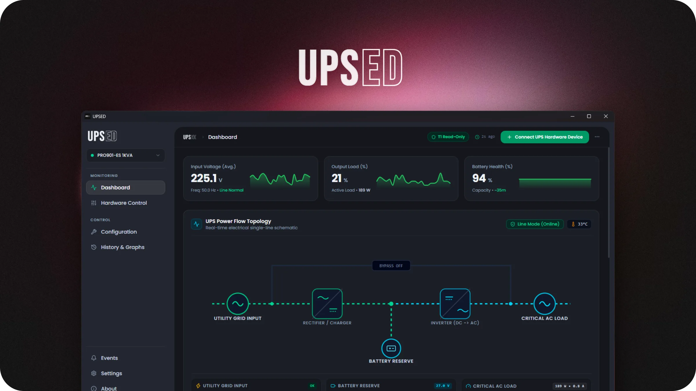

<p align="center">
  <picture>
    
  </picture>
</p>

# UPSED — Cross-Platform Voltronic UPS Manager

> **Pronunciation:** */juː-piː-ɛst/* • **“U-P-S'd”** (you-pee-ess-d) — *Seamlessly protected and uninterrupted by an Uninterruptible Power Supply.*

UPSED is a modern, high-performance, native desktop application for monitoring, configuring, and analyzing **Voltronic Power** uninterruptible power supplies (UPS) and rebranded hardware (e.g., Axpert, Mecer, MPP Solar, Effekta, RCT, Prolink).

Built with **Tauri v2**, **Rust**, **React 19**, and **Tailwind CSS v4**, UPSED is an independent, clean-room reimplementation designed to replace the legacy Java/Struts2/Tomcat ViewPower stack. It communicates directly with your UPS over USB HID or RS-232 serial with zero external web servers, zero background RMI ports, and an incremental **Safety Command Gate** to safeguard inverter firmware and connected loads.

---

## 📑 Table of Contents

- [Core Features](#-core-features)
- [Documentation & Deep-Dive Guides](#-documentation--deep-dive-guides)
- [Getting Started](#-getting-started)
  - [Prerequisites](#prerequisites)
  - [Installation & Development](#installation--development)
  - [macOS Installation & Local Network Permissions](#-macos-installation--local-network-permissions)
- [Usage Guide](#-usage-guide)
- [Clean-Room Legal & Fair Use Notice](#-clean-room-legal--fair-use-notice)
- [License](#-license)

---

## ✨ Core Features

- **Direct Hardware & Multi-UPS Support:** Native USB HID (`0665:5161`) and RS-232/COM serial communication with non-destructive Stage T1 auto-discovery and concurrent multi-device monitoring.
- **4-Stage Safety Command Gate:** Strongly typed `VoltronicCommand` barrier protected by Windows Hello / macOS Touch ID / Linux Polkit and Argon2id credentials, preventing raw command injection and accidental power cuts.
- **Comprehensive Power Control:** Delayed shutdown (`S.<M>`), shutdown & auto-restore (`S..R..`), inverter toggle (`SON`/`SOFF`), switchable outlets (`SKON`/`SKOFF`), and active countdown abort (`CS`).
- **Outage & Data Gap Analytics:** Hybrid blackout bands, diagonal-hatched communication gap overlays, and configurable SQL window downsampling (`1,500`–`10,000` points or `Raw`).
- **Peukert Battery & Runtime Modeling:** Calibrated VRLA/AGM, Gel, and LiFePO4 chemistry profiles with C-rate derated runtime estimation.
- **Headless System Tray & OS Notifications:** Unloads WebView2 completely when minimized to tray (`0%` UI CPU/RAM), pauses animations when unfocused, and dispatches native OS notifications from Rust.
- **Events Hub, Themes & i18n:** SQLite WAL persistence with CSV export, System/Light/Dark themes, and English (`en`) / French (`fr`) localization.
- **Signed Auto-Updates & Release Integrity:** Tauri v2 signed updates (`latest.json` + `.sig`) with `manifest.json` SHA-256 verification for desktop installers and bridge firmware.
- **ESP32-S3 IoT Bridge & Wireless OTA:** Wi-Fi WebSocket / USB CDC gateway with a 32,768-record PSRAM flight recorder, TuyaLink MQTT, and leased wireless OTA flashing.
- **Opt-In OS Battery Bridge:** Virtual laptop battery emulation on Windows tray, Linux UPower (`/dev/uhid`), and macOS `IOPMLib`.

> See **[Detailed Features Guide](docs/FEATURES.md)** for full technical specifications.

---

## 📚 Documentation & Deep-Dive Guides

- **[Detailed Features Guide](docs/FEATURES.md)** — Full breakdown of hardware transports, power controls, analytics, tray lifecycle, themes, and IoT capabilities.
- **[Architecture, Safety Gate & Runtime Math](docs/ARCHITECTURE_AND_SAFETY.md)** — Clean-room vs. ViewPower architecture diagrams, telemetry pipeline, 4-stage CommandGate table, and Peukert battery physics.
- **[Automatic Updates & Release Signing](docs/AUTO_UPDATE_AND_SIGNING.md)** — Tauri v2 signed updater (`latest.json` + `.sig`), `manifest.json` SHA-256 verification, keypair generation, and GitHub Actions release secrets.
- **[Testing Strategy](docs/TESTING.md)** — Breakdown of all 12 mock-hardware integration suites and library unit tests.
- **[ESP32-S3 IoT Hardware Bridge](upsed-bridge/README.md)** — Hardware wiring, Wi-Fi WebSocket gateway, PSRAM flight recorder, and wireless OTA flashing.
- **[Protocol Specification](docs/PROTOCOL_SPEC.md)** & **[Tuya Integration Guide](docs/TUYA_INTEGRATION_GUIDE.md)** — Voltronic wire protocol reference and TuyaLink DP mapping.

---

## 🚀 Getting Started

### Prerequisites

Ensure the following are installed:

- **Node.js:** v18+ (v20+ recommended) and `npm`
- **Rust:** 1.77+ (`rustup` with MSVC toolchain on Windows, GCC/Clang on Linux/macOS)
- **C++ Build Tools:**
  - *Windows:* Visual Studio C++ Build Tools
  - *Linux:* `libwebkit2gtk-4.1-dev`, `build-essential`, `curl`, `wget`, `file`, `libssl-dev`, `libgtk-3-dev`, `libayatana-appindicator3-dev`, `librsvg2-dev`, `libudev-dev`
  - *macOS:* Xcode Command Line Tools

### Installation & Development

1. **Clone the repository:**

   ```bash
   git clone https://github.com/Sandakan/UPSED.git
   cd UPSED
   ```

2. **Install frontend dependencies:**

   ```bash
   npm install
   ```

3. **Run the mock-hardware test suite:**

   ```bash
   cd src-tauri
   cargo test
   cd ..
   ```

   *All 112 active unit and mock-hardware tests across 12 integration suites + library unit tests must pass with 0 failures before launching (2 live-hardware HID tests are ignored by default).*

4. **Launch Development Mode:**

   ```bash
   npm run tauri dev
   ```

5. **Build Production Application:**

   ```bash
   npm run tauri build
   ```

### 🍎 macOS Installation & Local Network Permissions

When installing the packaged DMG (`UPSED_<version>_aarch64.dmg` or `UPSED_<version>_x64.dmg`) on macOS:

1. **Install to Applications:**
   Open the DMG disk image and drag **UPSED.app** into **/Applications**.
   > [!IMPORTANT]
   > Do **not** launch UPSED directly from inside the mounted DMG volume. Running from the disk image triggers macOS Gatekeeper **App Translocation**, which places the app in a temporary isolated sandbox container and blocks local network traffic (mDNS `.local` host resolution, UDP broadcasts, and WebSocket bridge communication).

2. **Clear Quarantine & Re-Sign Bundle (macOS Sequoia 15+ / Ad-Hoc Builds):**
   For ad-hoc signed releases or newly packaged builds on macOS 15+, run the following in Terminal to remove Gatekeeper download flags and bind the application bundle identity to `Info.plist`:

   ```bash
   # Clear macOS download quarantine attribute
   xattr -cr /Applications/UPSED.app

   # Sign the application bundle with ad-hoc signature to bind Info.plist permissions
   codesign --force --deep -s - /Applications/UPSED.app
   ```

3. **Grant Local Network Access:**
   - On first launch, macOS displays a privacy prompt: ***"UPSED" would like to find and connect to devices on your local network***. Click **Allow**.
   - If the dialog was previously dismissed, navigate to **System Settings > Privacy & Security > Local Network** and verify that **UPSED** is toggled **ON**.

> For configuring signed in-app auto-updates and release signing keys, see **[Automatic Updates & Release Signing](docs/AUTO_UPDATE_AND_SIGNING.md)**.

---

## 📖 Usage Guide

### 1. Connecting to a UPS

1. Connect your UPS via USB (native USB HID `VID 0665 PID 5161` or USB-Serial adapter) or RS-232 serial cable.
2. Launch UPSED.
3. Click **+ Connect UPS Device** in the top bar (or open the top-bar UPS picker and click **Recheck**).
4. UPSED probes serial and USB HID interfaces using Stage T1 read-only queries (`QPI\r`).
5. Detected units appear with their device identifier (e.g. `USB:0665:5161:1D9528FA` or `COM3`) and protocol variant (e.g. `P01`, `P17`, `P00`). Click any device to monitor telemetry.

### 2. Live Monitoring (Dashboard)

- **Grid AC Input:** Live input voltage and line frequency with utility failure alarm detection.
- **Output Load:** Percentage load, real/profile-estimated active wattage (automatically computed from rated VA/watts when `Q1` reports `0W`), and dynamic color-coded load indicators.
- **Battery Bank:** DC bus voltage, estimated State-of-Charge (SoC), active runtime estimate, and low-voltage alarms.
- **Inverter Thermals:** Internal heatsink operating temperatures.
- **Power Flow Diagram:** GPU-composited (`translate3d`) animated energy flow between Utility Grid, Inverter/Charger, Battery Bank, and AC Output, automatically paused when minimized or unfocused.

### 3. Hardware Events & Alarms (Events Tab)

- Switch to the **Events** tab via the sidebar `Bell` icon.
- Review real-time hardware state transitions (blackouts, restorations, low battery warnings, overloads, and high temperatures).
- Filter by severity badges (`Critical`, `Warning`, `Success`, `Info`) or search by keyword and port.
- Individual event acknowledgment (`Ack`), bulk acknowledgment, and one-click **Export CSV**.

### 4. Diagnostics & Hardware Control (Stage T2 & T4)

- Switch to the **Hardware Control** tab.
- **Toggle Buzzer (T2):** Mute or unmute the internal UPS beeper (`Q`).
- **Battery Self-Test (T2):** Run a 10s battery discharge diagnostic (`T`), custom timed test (`T<n>`), or cancel an active test (`CT`).
- **Emergency Shutdown (T4):** Delayed output shutdown with dual-confirmation countdown dialogs to prevent accidental power loss.

### 5. Hardware Configurations (Stage T3)

- Navigate to the **Configuration** tab.
- Safely update charging parameters such as maximum solar/utility charging current (`MCHGC`) or bypass voltage tolerances (`PBVH`/`PBVL`).
- Inputs outside safe physical limits are blocked by Rust before transmission.

### 6. Historical Telemetry & Graphs

- Go to the **History & Graphs** tab.
- Inspect timestamped records of voltage, load, and battery metrics stored in SQLite.
- Review waveform graphs with zoom/pan, outage highlighting bands, and data gap visualization.
- Click **Export CSV** to download tabular data (`upsed-telemetry-...` and `upsed-events-...`).

### 7. Application Settings & Profile Configuration

- **Hardware Profile Setup:** Configure rated VA, power factor, battery chemistry, and topology for accurate runtime math.
- **Telemetry Polling Interval:** Configure polling frequency (2s, 5s, 10s default, 30s, or 60s).
- **Historical Graph Resolution:** Choose downsampling threshold (1,500, 3,000, 5,000, 10,000, or Raw).
- **System Tray & Window Lifecycle:** Toggle "Close to Minimize" and "Start Minimized in Tray".
- **System Autostart:** Enable automatic startup on operating system login.
- **Outage Highlighting on Graphs:** Toggle shaded red background blackout bands across time-series charts.
- **Language Selection:** Choose between System Default, English, or French.
- **Theme Selection:** Toggle between System Default, Light, or Dark mode.
- **OS Native Battery Bridge:** Opt-in toggle to emulate a system battery widget.
- **About UPSED Dialog:** Access phonetic guide (`/juː-piː-ɛst/`), version info, live GitHub **Changelog** viewer (`master` branch), **Check for Updates**, license details, and clean-room legal notices via the sidebar footer.

---

## ⚖️ Clean-Room Legal & Fair Use Notice

This software is an independent clean-room engineering effort created for **interoperability purposes** under:

- **United States Code:** 17 U.S.C. § 1201(f) (Reverse Engineering / Interoperability exemption of the DMCA).
- **European Union:** Directive 2009/24/EC, Article 6 (Decompilation for Interoperability).

UPSED contains **no copyrighted binaries, proprietary Java bytecode, or graphic assets** from Voltronic Power Technology Corp. or its software ViewPower. Voltronic ASCII serial communication is a publicly documented industrial standard supported by open-source systems such as Network UPS Tools (NUT).

---

## 📄 License

Licensed under the MIT License. See [LICENSE](./LICENSE) for details.
