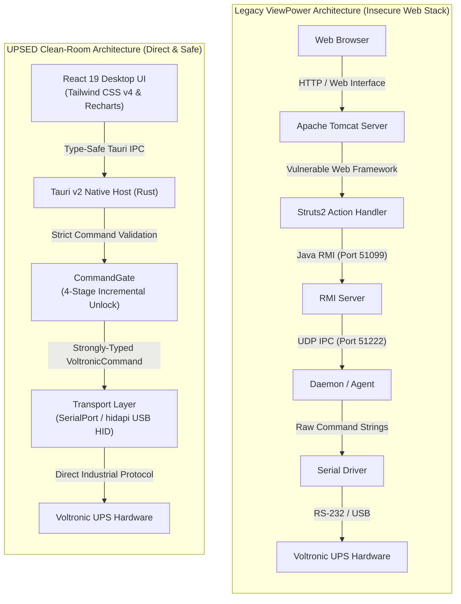
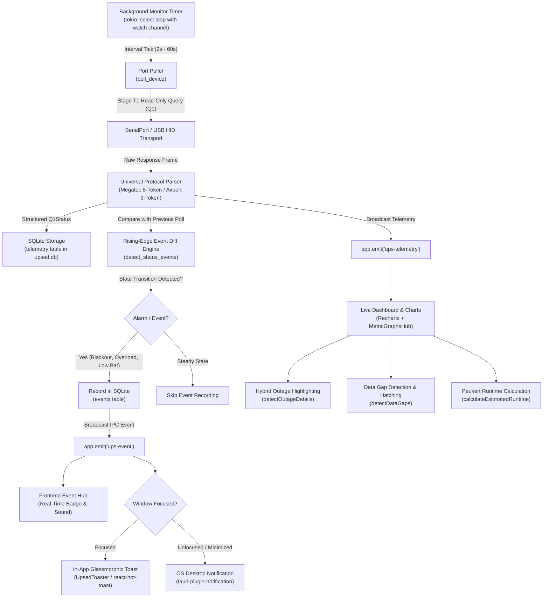

<p align="center">
  <picture>
    
  </picture>
</p>

# UPSED — Cross-Platform Voltronic UPS Manager

> **Pronunciation:** */juː-piː-ɛst/* • **“U-P-S'd”** (you-pee-ess-d) — *Seamlessly protected and uninterrupted by an Uninterruptible Power Supply.*

UPSED is a modern, high-performance, native desktop application for monitoring, configuring, and analyzing **Voltronic Power** uninterruptible power supplies (UPS) and rebranded hardware (e.g., Axpert, Mecer, MPP Solar, Effekta, RCT, Prolink).

Built with **Tauri v2**, **Rust**, **React 19**, and **Tailwind CSS v4**, UPSED is an independent, clean-room reimplementation designed to replace the legacy Java/Struts2/Tomcat ViewPower stack. It communicates directly with your UPS over USB HID or RS-232 serial with zero external web servers, zero background RMI ports, and an incremental **Safety Command Gate** to safeguard inverter firmware and connected loads.

---

## ✨ Core Features

### ⚡ Direct Hardware Communication & Multi-Device Support

- Connects directly to native USB HID interfaces (`VID 0x0665 / PID 0x5161` via `hidapi`) or RS-232/USB serial COM ports (`serialport` crate).
- Zero external drivers, zero Java runtime, zero Tomcat web servers, and zero open network listening ports.
- Safely auto-discovers connected hardware on both USB HID and COM ports using strictly non-destructive Stage T1 read-only queries (`QPI\r`).
- Concurrent multi-UPS management with independent communication channels and telemetry caches.

### 🛡️ Safety-First Command Gate & Authenticated Permission Barrier

- Enforces a ViewPower-style user permission barrier atop a 4-tier risk classification:
  - **Stage T1 (Read-Only):** Non-modifying telemetry queries (`QPI`, `Q1`, `QPIGS`, `QPIWS`) remain open without authentication for auto-discovery and telemetry monitoring.
  - **Stages T2–T4 (Protected):** Diagnostic self-tests (`T`, `CT`), persistent EEPROM writes (`MCHGC`, `PBVH`, `PBVL`), and power control require an active authenticated administrator session.
  - **Stage T4 (Power Control):** Live load-drop operations (`ShutdownWithDelay`, `ShutdownAndRestore`, `OutputOff`, `OutletOff`) require typed confirmation ("type UPS name or SHUTDOWN") before transmission.
- Credential protection using **Argon2id** password hashing stored in the OS native credential manager (macOS Keychain, Windows Credential Manager, Linux Secret Service) with secure SQLite fallback.
- In-memory sliding session expires after 15 minutes of inactivity; brute-force protection locks out login after 5 failed attempts.
- Completely eliminates raw string command injection vulnerabilities (such as ViewPower's `controlNew` flaw). Every interaction is a strongly typed variant of the `VoltronicCommand` enum.
- Strict physical parameter bounds validation in Rust before any byte payload reaches the transport layer.

### ⚡ Comprehensive UPS Power Management

- **Delayed Output Shutdown (`S.<M>` / `S<M>`):** Safely power off AC inverter output after a configurable delay (presets from 18 seconds to 10 minutes, or custom minutes 0.1–99).
- **Shutdown & Auto-Restore (`S..R..`):** Shuts down AC output after delay, then automatically re-engages output once mains AC returns and a restore timer elapses.
- **Inverter Output Toggle (`SON` / `SOFF`):** Directly toggle inverter output on/off for P-series hardware without powering down internal monitoring logic.
- **Switchable Outlet Groups (`SKON` / `SKOFF`):** Independently control outlet banks 1 and 2 for smart load shedding and peripheral equipment cycling.
- **Active Shutdown Countdown & Abort:** Real-time ticker synchronized with the hardware status bit (`shutdown_active`) and one-click immediate abort (`CS`).
- **Host PC Power Safety Guard:** Prominent warnings prevent accidental power cuts to the machine running UPSED.

### 📉 Real-Time Outage Interval Detection

- Hybrid outage detection combining physical voltage thresholds (< 50V line failure) with rising-edge event correlation (`UTILITY_FAIL` and `UTILITY_RESTORE`).
- Automatic real-time status tracking with visual outage bands across charts (`OutageReferenceArea`) highlighting ongoing blackouts with live `Outage (Active)` badges.

### 🔍 Data Gap Visualization & Offline Highlighting

- Automatically flags communication gaps and offline periods when the delta exceeds `max(3.5 * medianStepMs, 3 * pollIntervalSecs, 45s)`.
- Renders responsive SVG diagonal hatch pattern textures (`DataGapReferenceArea`) across time-series charts.
- Responsive duration formatting (`45s`, `14m`, `2h 15m`, `1d 6h`) with dynamic label density (expanded label at ≥ 110px width, concise "No Data" at 60–109px, subtle texture without text at < 60px).
- Boundary anchor point injection (`injectGapAnchorPoints`) preserves true proportional duration along categorical time axes without misleading line interpolation.

### 📊 Configurable Time-Series Downsampling (LTTB / SQL Decimation)

- Balances high-frequency waveform fidelity with rapid UI rendering across extensive historical datasets.
- User-selectable graph resolution thresholds in Settings:
  - **1,500 points** — Aggressive / Lightest (ideal for low-power machines or long historical spans)
  - **3,000 points** — Balanced
  - **5,000 points** — Default (High Detail)
  - **10,000 points** — Ultra Detail
  - **Raw Data** — Unlimited (No decimation)
- Server-side SQL window decimation engine uses `ROW_NUMBER() OVER (ORDER BY id ASC)` with step modulus `(rn - 1) % step = 0` to preserve uniform temporal distribution and constant memory footprint across large historical time spans, with Raw Data mode for uncompressed transient analysis.

### 🌐 Internationalization (i18n) Multi-Language Support

- Comprehensive multi-language support covering **English (`en`)** and **French (`fr`)**.
- Modular localization across 10 translation namespaces: `common`, `nav`, `dashboard`, `control`, `config`, `history`, `events`, `settings`, `modals`, and `notifications`.
- Automatic system locale detection (`getSystemLanguage`) with explicit user overrides persisted across sessions.
- Locale-aware timestamp formatting integrated with `date-fns/locale` (`enUS`, `fr`).

### 🔋 Hardware Profile & Peukert Active Runtime Estimation

- Configurable UPS metadata specifications: Rated VA, Power Factor (0.6 Line-Interactive, 0.8 Business/Server, 0.9 Online, 1.0 Unity Enterprise), and calculated Rated Active Watts.
- Multi-chemistry battery modeling: Standard Sealed Lead-Acid (VRLA / AGM), Gel Cell, and Lithium Iron Phosphate (LiFePO4) with calibrated cell cutoff, nominal, and float voltages.
- Peukert load-derated discharge runtime estimation modeling non-linear capacity drop under high C-rate discharge (accounting for ~90–93% inverter conversion efficiency).

### 🖥️ Background Tray Lifecycle & Autostart

- System tray icon with live battery capacity rendering, operational tooltips, and desktop menu ("Open UPSED", "Quit UPSED").
- Seamless minimize-to-tray on window close (`close_to_minimize` preference prevents application exit).
- Start minimized in tray capability (`start_minimized` preference and `--minimized` launch argument).
- System startup integration via `tauri-plugin-autostart` (Windows Registry Run key, macOS LaunchAgent, Linux XDG autostart).
- Native cold-boot dark background initialization (`#22262f`) eliminating white or black screen flash before initial paint.

### 🎨 System / Light / Dark Theme Engine

- Full support for **System Default**, **Light**, and **Dark** themes with instant, flash-free transitions.
- Dynamically responds to OS color scheme shifts via `prefers-color-scheme` media queries when set to System mode.
- Dual-layer synchronization across frontend `localStorage` (`upsed-theme-mode`) and the SQLite settings store.

### 📋 Events Hub & SQLite Persistence

- Dedicated Events Hub with real-time unread counter, severity classification (`Critical`, `Warning`, `Success`, `Info`), keyword search, and CSV export.
- Embedded SQLite storage (`%APPDATA%\com.adsandakannipunajith.upsed\upsed.db`) with automatic WAL journal mode.

### 📝 Diagnostic Logging & Window Persistence

- Multi-target structured logging powered by `tauri-plugin-log`: streams to terminal `stdout`, webview console, and local rotating log files (`%LOCALAPPDATA%\com.adsandakannipunajith.upsed\logs\upsed.log`).
- Window geometry persistence via `tauri-plugin-window-state`: remembers dimensions, screen position, and maximized state across reboots.

### 📡 ESP32-S3 IoT Hardware Bridge & Wireless OTA Flashing

- **Wireless Hardware Gateway:** Connects UPS units to UPSED over 2.4GHz Wi-Fi WebSocket (`ws://upsed-bridge.local:81`) or high-speed USB CDC Serial (115,200 baud).
- **8MB PSRAM MessagePack Ring Buffer:** Buffers up to 8,192 offline telemetry samples (~22.7 hours at 10s cadence) while PC is asleep or off, synchronizing into SQLite history on reconnect.
- **On-Demand Leased Wireless OTA Flashing:**
  - **In-App Desktop OTA:** One-click wireless flashing from GitHub releases or local builds directly from the UPSED UI.
  - **PlatformIO CLI:** `npm run bridge:ota` for terminal flashing over Wi-Fi.
  - **Fail-Safe Security:** Port 8080 opened strictly for 90 seconds on-demand with a hardware watchdog lease; requires `UPSED_OTA_SECRET` authentication token in `.env`. Telemetry UART paused during flash.
- **Multi-State WS2812 RGB Status LED Engine:** Priority-ranked 60Hz hardware indicator communicating real-time operational states (Solid Green proxy, Breathing Cyan standalone logging, Pulsing Red power outage), network alerts (Wi-Fi connecting/auth fail and TuyaLink status overlays), and dual-stage OTA feedback (Blinking Magenta authentication & Pulsing Magenta firmware streaming).

### 🔋 OS Native Battery Bridge (Opt-In)

- Emulates an internal system battery for desktop operating systems:
  - **Windows:** Custom taskbar tray battery level gauge & tooltips.
  - **Linux:** Virtual HID device via `/dev/uhid` recognized by UPower for GNOME/KDE desktop battery widgets.
  - **macOS:** Native menu bar power source integration via `IOPMLib`.
- **Strictly opt-in:** Disabled by default to respect user system preferences.

---

## 🏛️ Visual Architecture & Flow Diagrams

### 1. ViewPower Legacy Web Stack vs. UPSED Clean-Room Desktop Architecture



### 2. Telemetry Polling, Outage Detection & Event Diffing Pipeline



---

## 🛡️ Safety Command Gate & Authenticated Permission Barrier

To safeguard connected equipment and prevent persistent EEPROM corruption or unintended power cuts, UPSED categorizes every hardware command into 4 risk tiers guarded by an authenticated user barrier:

| Stage | Risk Level | Allowed Commands | Access Barrier & Invariants |
| --- | --- | --- | --- |
| **Stage T1 (Read-Only)** | None | `QPI` (Protocol ID), `Q1` (Quick Status), `QPIGS` (General Status), `QPIWS` (Warnings), `QPIRI` (Ratings), `QID` (Serial No.), `QVFW` (Firmware Ver.), `QSK1`/`QSK2` (Outlet states) | **Open unconditionally.** Automated hardware scans, discovery probes, and telemetry polling strictly use Stage T1 commands. |
| **Stage T2 (Non-Destructive)** | Low | `Q` (Toggle beeper), `T` / `T<n>` (10s/timed battery test), `CT` (Cancel battery test) | **Requires Authenticated Session.** Observable diagnostics that do not alter flash/EEPROM or drop live load. |
| **Stage T3 (Config Writes)** | Medium | `MCHGC` (Charge current), `PBVH`/`PBVL` (Bypass window), `PSDV` (Cutoff voltage) | **Requires Authenticated Session.** Persistent EEPROM writes; parameters must pass pre-validation against physical equipment safety limits in Rust before transmission. |
| **Stage T4 (Power Control)** | High | `S.<M>` / `S<M>` (Delayed shutdown), `S..R..` (Shutdown & restore), `SON`/`SOFF` (Inverter toggle), `SKON`/`SKOFF` (Outlet control), `CS` (Cancel shutdown) | **Requires Authenticated Session + Typed Confirmation.** High-risk commands that cut output power require typing the target UPS name or `SHUTDOWN` to prevent accidental load drops. |

---

## 📐 Hardware Specifications & Runtime Estimation Math

UPSED implements accurate battery physics models based on Peukert's law and inverter topology efficiency:

### 1. Battery Chemistries & Cell Voltage Thresholds

| Chemistry | Nominal Cell Voltage | Cutoff Voltage (0% under load) | Float Voltage (100% ceiling) | Peukert Exponent ($k$) |
| --- | --- | --- | --- | --- |
| **VRLA / AGM (Standard Lead-Acid)** | 2.00 V/cell | 1.75 V/cell | 2.28 V/cell (27.36V on 24V pack) | 1.25 |
| **GEL Cell Lead-Acid** | 2.00 V/cell | 1.80 V/cell | 2.30 V/cell | 1.20 |
| **LiFePO4 (Lithium Iron Phosphate)** | 3.20 V/cell | 2.80 V/cell | 3.45 V/cell | 1.05 |

### 2. Peukert Discharge Derating & Runtime Calculation

Lead-acid batteries deliver significantly less total energy when discharged at high C-rates. The runtime estimation engine calculates:

$$\text{Remaining Energy (Wh)} = V_{\text{nominal}} \times \text{Capacity}_{\text{Ah}} \times \left(\frac{\text{SoC}\%}{100}\right) \times \eta_{\text{inverter}}$$

$$\text{Discharge Current (A)} = \frac{P_{\text{load}}}{\left(V_{\text{nominal}} \times \eta_{\text{inverter}}\right)}, \quad \text{C-Rate} = \frac{\text{Discharge Current}}{\text{Capacity}_{\text{Ah}}}$$

$$\text{Runtime (Hours)} = \frac{\text{Remaining Energy} \times k_{\text{Peukert}}}{P_{\text{load}}}$$

- **Inverter Efficiency ($\eta$):** $\approx 90\%$ for Online Double-Conversion; $\approx 93\%$ for Line-Interactive topologies.
- **Peukert Derating Factor ($k_{\text{Peukert}}$ for VRLA):**
  - $\ge 1.5\text{C}$ discharge: $0.50$
  - $\ge 0.8\text{C}$ discharge: $0.58$ (typical 1C rate)
  - $\ge 0.4\text{C}$ discharge: $0.70$
  - $\ge 0.2\text{C}$ discharge: $0.82$
  - $< 0.2\text{C}$ discharge: $0.92$
  - *LiFePO4 maintains a flat $0.95$ derating across high discharge rates.*

---

## 🚀 Getting Started

### Prerequisites

Ensure the following are installed:

- **Node.js:** v18+ (v20+ recommended) and `npm`
- **Rust:** 1.77+ (`rustup` with MSVC toolchain on Windows, GCC/Clang on Linux/macOS)
- **C++ Build Tools:**
  - *Windows:* Visual Studio C++ Build Tools
  - *Linux:* `libwebkit2gtk-4.1-dev`, `build-essential`, `curl`, `wget`, `file`, `libssl-dev`, `libgtk-3-dev`, `libayatana-appindicator3-dev`, `librsvg2-dev`, `libudev-dev`
  - *macOS:* Xcode Command Line Tools

### Installation & Development

1. **Clone the repository:**

   ```bash
   git clone https://github.com/Sandakan/UPSED.git
   cd UPSED
   ```

2. **Install frontend dependencies:**

   ```bash
   npm install
   ```

3. **Run the mock-hardware test suite:**

   ```bash
   cd src-tauri
   cargo test
   cd ..
   ```

   *All 61 mock-hardware tests across 9 test suites must pass with 0 failures before launching.*

4. **Launch Development Mode:**

   ```bash
   npm run tauri dev
   ```

5. **Build Production Application:**

   ```bash
   npm run tauri build
   ```

---

## 📖 Usage Guide

### 1. Connecting to a UPS

1. Connect your UPS via USB (native USB HID `VID 0665 PID 5161` or USB-Serial adapter) or RS-232 serial cable.
2. Launch UPSED.
3. Click the **Scan (Search)** button in the sidebar under **Connected Devices**.
4. UPSED probes serial and USB HID interfaces using Stage T1 read-only queries (`QPI\r`).
5. Detected units appear with their device identifier (e.g. `USB:0665:5161:1D9528FA` or `COM3`) and protocol variant (e.g. `P01`, `P17`, `P00`). Click any device to monitor telemetry.

### 2. Live Monitoring (Dashboard)

- **Grid AC Input:** Live input voltage and line frequency with utility failure alarm detection.
- **Output Load:** Percentage load, real active wattage, and dynamic color-coded load indicators.
- **Battery Bank:** DC bus voltage, estimated State-of-Charge (SoC), active runtime estimate, and low-voltage alarms.
- **Inverter Thermals:** Internal heatsink operating temperatures.
- **Power Flow Diagram:** Live animated energy flow between Utility Grid, Inverter/Charger, Battery Bank, and AC Output.

### 3. Hardware Events & Alarms (Events Tab)

- Switch to the **Events** tab via the sidebar `Bell` icon.
- Review real-time hardware state transitions (blackouts, restorations, low battery warnings, overloads, and high temperatures).
- Filter by severity badges (`Critical`, `Warning`, `Success`, `Info`) or search by keyword and port.
- Individual event acknowledgment (`Ack`), bulk acknowledgment, and one-click **Export CSV**.

### 4. Diagnostics & Hardware Control (Stage T2 & T4)

- Switch to the **Hardware Control** tab.
- **Toggle Buzzer (T2):** Mute or unmute the internal UPS beeper (`Q`).
- **Battery Self-Test (T2):** Run a 10s battery discharge diagnostic (`T`), custom timed test (`T<n>`), or cancel an active test (`CT`).
- **Emergency Shutdown (T4):** Delayed output shutdown with dual-confirmation countdown dialogs to prevent accidental power loss.

### 5. Hardware Configurations (Stage T3)

- Navigate to the **Configuration** tab.
- Safely update charging parameters such as maximum solar/utility charging current (`MCHGC`) or bypass voltage tolerances (`PBVH`/`PBVL`).
- Inputs outside safe physical limits are blocked by Rust before transmission.

### 6. Historical Telemetry & Graphs

- Go to the **History & Graphs** tab.
- Inspect timestamped records of voltage, load, and battery metrics stored in SQLite.
- Review waveform graphs with zoom/pan, outage highlighting bands, and data gap visualization.
- Click **Export CSV** to download tabular data (`upsed-telemetry-...` and `upsed-events-...`).

### 7. Application Settings & Profile Configuration

- **Hardware Profile Setup:** Configure rated VA, power factor, battery chemistry, and topology for accurate runtime math.
- **Telemetry Polling Interval:** Configure polling frequency (2s, 5s, 10s default, 30s, or 60s).
- **Historical Graph Resolution:** Choose downsampling threshold (1,500, 3,000, 5,000, 10,000, or Raw).
- **System Tray & Window Lifecycle:** Toggle "Close to Minimize" and "Start Minimized in Tray".
- **System Autostart:** Enable automatic startup on operating system login.
- **Outage Highlighting on Graphs:** Toggle shaded red background blackout bands across time-series charts.
- **Language Selection:** Choose between System Default, English, or French.
- **Theme Selection:** Toggle between System Default, Light, or Dark mode.
- **OS Native Battery Bridge:** Opt-in toggle to emulate a system battery widget.
- **About UPSED Dialog:** Access phonetic guide (`/juː-piː-ɛst/`), version info, license details, and clean-room legal notices via the sidebar footer or Settings.

---

## 🧪 Testing Strategy

UPSED includes an in-memory mock-hardware test suite in `src-tauri/tests/`:

- `stage_t1_tests.rs`: Validates Q1, QPIGS, QPIWS, QID, QVFW, QPIRI parsing, timeout handling, and read-only gating.
- `stage_t1_hid_tests.rs`: Tests USB HID candidate detection, VID matching, and null-padded frame decoding.
- `stage_t2_tests.rs`: Tests buzzer toggle and 10s battery test commands and gate enforcement.
- `stage_t3_tests.rs`: Tests parameter validation (charge current, voltage windows, battery floors).
- `stage_t4_tests.rs`: Tests shutdown and outlet delay validation.
- `security_and_gate_tests.rs`: Verifies that no arbitrary raw string commands can be passed, stages cannot be bypassed, and rising-edge events trigger accurately.
- `concurrency_tests.rs`: Verifies multi-port isolation and independent device polling.
- `battery_bridge_tests.rs`: Confirms that the OS battery bridge remains strictly disabled by default.
- `monitor_tests.rs`: Verifies application settings persistence, watch channel interval updates, and legacy SQLite database migration.

Run all tests:

```bash
cd src-tauri
cargo test
```

---

## ⚖️ Clean-Room Legal & Fair Use Notice

This software is an independent clean-room engineering effort created for **interoperability purposes** under:

- **United States Code:** 17 U.S.C. § 1201(f) (Reverse Engineering / Interoperability exemption of the DMCA).
- **European Union:** Directive 2009/24/EC, Article 6 (Decompilation for Interoperability).

UPSED contains **no copyrighted binaries, proprietary Java bytecode, or graphic assets** from Voltronic Power Technology Corp. or its software ViewPower. Voltronic ASCII serial communication is a publicly documented industrial standard supported by open-source systems such as Network UPS Tools (NUT).

---

## 📄 License

Licensed under the MIT License. See [LICENSE](./LICENSE) for details.
