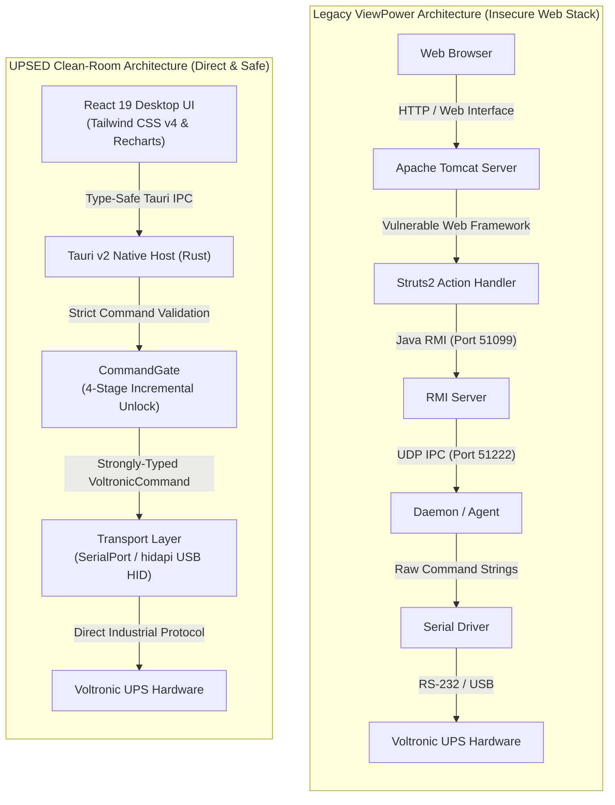
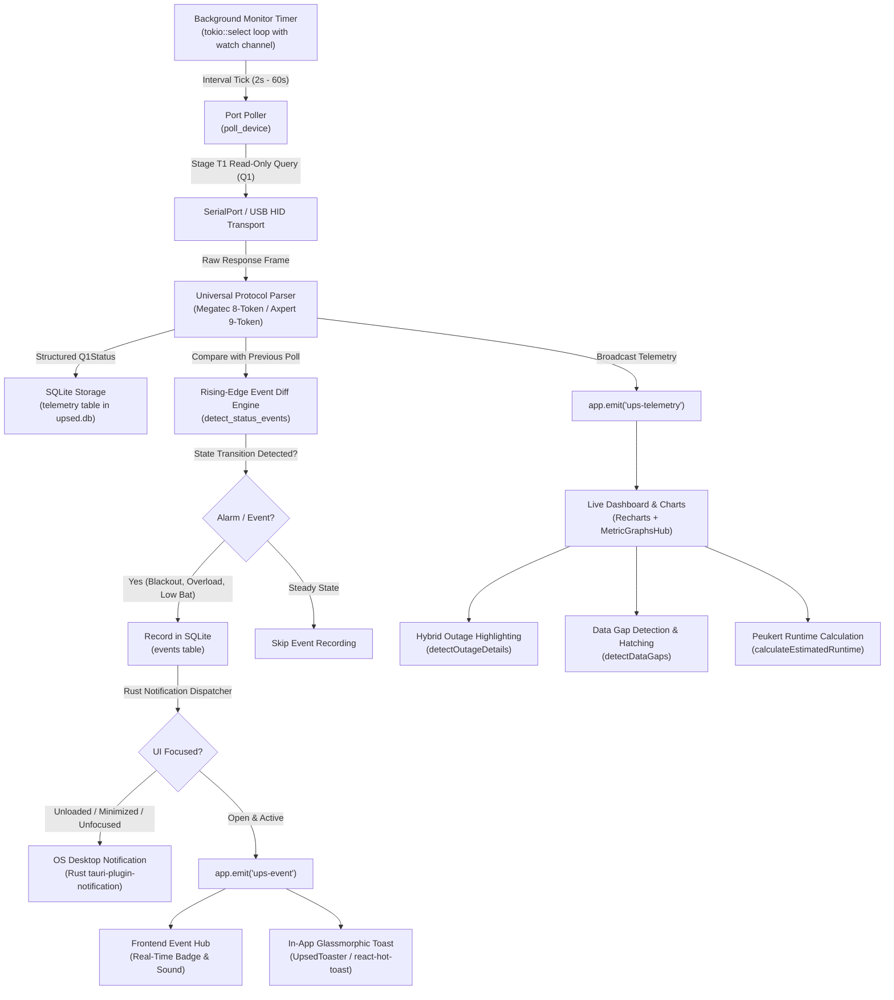

# Architecture, Safety Gate & Runtime Math

> Back to [README](../README.md)

## Table of Contents

- [Visual Architecture & Flow Diagrams](#visual-architecture--flow-diagrams)
  - [1. ViewPower Legacy Web Stack vs. UPSED Clean-Room Desktop Architecture](#1-viewpower-legacy-web-stack-vs-upsed-clean-room-desktop-architecture)
  - [2. Telemetry Polling, Outage Detection & Event Diffing Pipeline](#2-telemetry-polling-outage-detection--event-diffing-pipeline)
- [Safety Command Gate & Authenticated Permission Barrier](#safety-command-gate--authenticated-permission-barrier)
- [Hardware Specifications & Runtime Estimation Math](#hardware-specifications--runtime-estimation-math)
  - [1. Battery Chemistries & Cell Voltage Thresholds](#1-battery-chemistries--cell-voltage-thresholds)
  - [2. Peukert Discharge Derating & Runtime Calculation](#2-peukert-discharge-derating--runtime-calculation)

---

## Visual Architecture & Flow Diagrams

### 1. ViewPower Legacy Web Stack vs. UPSED Clean-Room Desktop Architecture

### 2. Telemetry Polling, Outage Detection & Event Diffing Pipeline

---

## Safety Command Gate & Authenticated Permission Barrier

To safeguard connected equipment and prevent persistent EEPROM corruption or unintended power cuts, UPSED categorizes every hardware command into 4 risk tiers guarded by an authenticated user barrier:

| Stage | Risk Level | Allowed Commands | Access Barrier & Invariants |
| --- | --- | --- | --- |
| **Stage T1 (Read-Only)** | None | `QPI` (Protocol ID), `Q1` (Quick Status), `QPIGS` (General Status), `QPIWS` (Warnings), `QPIRI` (Ratings), `QID` (Serial No.), `QVFW` (Firmware Ver.), `QSK1`/`QSK2` (Outlet states) | **Open unconditionally.** Automated hardware scans, discovery probes, and telemetry polling strictly use Stage T1 commands. |
| **Stage T2 (Non-Destructive)** | Low | `Q` (Toggle beeper), `T` / `T<n>` (10s/timed battery test), `CT` (Cancel battery test) | **Requires Authenticated Session.** Observable diagnostics that do not alter flash/EEPROM or drop live load. |
| **Stage T3 (Config Writes)** | Medium | `MCHGC` (Charge current), `PBVH`/`PBVL` (Bypass window), `PSDV` (Cutoff voltage), Bridge Wi-Fi / TuyaLink / Failover / Clear Backlog | **Requires Authenticated Session.** Persistent EEPROM/NVS writes; parameters must pass pre-validation against physical equipment safety limits in Rust before transmission. |
| **Stage T4 (Power Control)** | High | `S.<M>` / `S<M>` (Delayed shutdown), `S..R..` (Shutdown & restore), `SON`/`SOFF` (Inverter toggle), `SKON`/`SKOFF` (Outlet control), `CS` (Cancel shutdown), `flash_bridge_firmware` (Wireless OTA) | **Requires Authenticated Session + Fresh OS Verification / Typed Confirmation.** High-risk commands that cut output power require typing the target UPS name or `SHUTDOWN` to prevent accidental load drops. |

---

## Hardware Specifications & Runtime Estimation Math

UPSED implements accurate battery physics models based on Peukert's law and inverter topology efficiency:

### 1. Battery Chemistries & Cell Voltage Thresholds

| Chemistry | Nominal Cell Voltage | Cutoff Voltage (0% under load) | Float Voltage (100% ceiling) | Peukert Exponent ($k$) |
| --- | --- | --- | --- | --- |
| **VRLA / AGM (Standard Lead-Acid)** | 2.00 V/cell | 1.75 V/cell | 2.28 V/cell (27.36V on 24V pack) | 1.25 |
| **GEL Cell Lead-Acid** | 2.00 V/cell | 1.80 V/cell | 2.30 V/cell | 1.20 |
| **LiFePO4 (Lithium Iron Phosphate)** | 3.20 V/cell | 2.80 V/cell | 3.45 V/cell | 1.05 |

### 2. Peukert Discharge Derating & Runtime Calculation

Lead-acid batteries deliver significantly less total energy when discharged at high C-rates. The runtime estimation engine calculates:

$$\text{Remaining Energy (Wh)} = V_{\text{nominal}} \times \text{Capacity}_{\text{Ah}} \times \left(\frac{\text{SoC}\%}{100}\right) \times \eta_{\text{inverter}}$$

$$\text{Discharge Current (A)} = \frac{P_{\text{load}}}{\left(V_{\text{nominal}} \times \eta_{\text{inverter}}\right)}, \quad \text{C-Rate} = \frac{\text{Discharge Current}}{\text{Capacity}_{\text{Ah}}}$$

$$\text{Runtime (Hours)} = \frac{\text{Remaining Energy} \times k_{\text{Peukert}}}{P_{\text{load}}}$$

- **Inverter Efficiency ($\eta$):** $\approx 90\%$ for Online Double-Conversion; $\approx 93\%$ for Line-Interactive topologies.
- **Peukert Derating Factor ($k_{\text{Peukert}}$ for VRLA):**
  - $\ge 1.5\text{C}$ discharge: $0.50$
  - $\ge 0.8\text{C}$ discharge: $0.58$ (typical 1C rate)
  - $\ge 0.4\text{C}$ discharge: $0.70$
  - $\ge 0.2\text{C}$ discharge: $0.82$
  - $< 0.2\text{C}$ discharge: $0.92$
  - *LiFePO4 maintains a flat $0.95$ derating across high discharge rates.*
