# UPSED × IoT — How It All Works
> A detailed process walkthrough: from UPS serial wire → UPSED Bridge (ESP32) → Home Assistant automation → Tuya Smart Life app
> Updated 2026-09-29 — includes UPSED Bridge hardware sub-project

---

## 1. The Big Picture — One UPS, Two Worlds

UPSED currently lives entirely on your Windows desktop. The IoT bridge extends it so that the UPS behaves like a first-class smart home device — while the existing desktop app continues to work exactly as before.

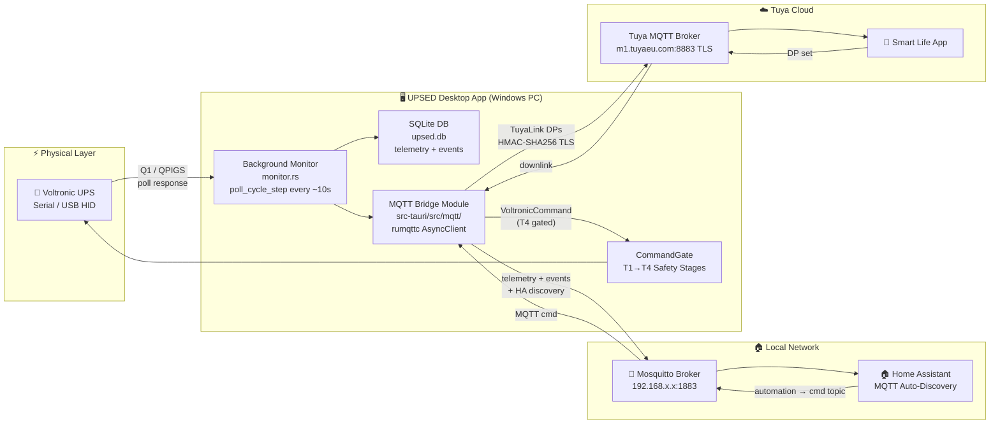

> [!IMPORTANT]
> **Nothing changes** for the existing UPSED UI — it continues receiving `ups-telemetry` and `ups-event` Tauri events exactly as today. The MQTT bridge is an **additive parallel output** hooked into the same poll cycle.

---

## 2. The Poll Cycle — The Engine That Drives Everything

This is the heartbeat of the entire system. It already exists in [`monitor.rs`](file:///c:/Users/adsan/Documents/My%20Projects/Projects/Desktop%20App%20Development/UPSED/src-tauri/src/monitor.rs). The IoT bridge slots in at **step 4** below.

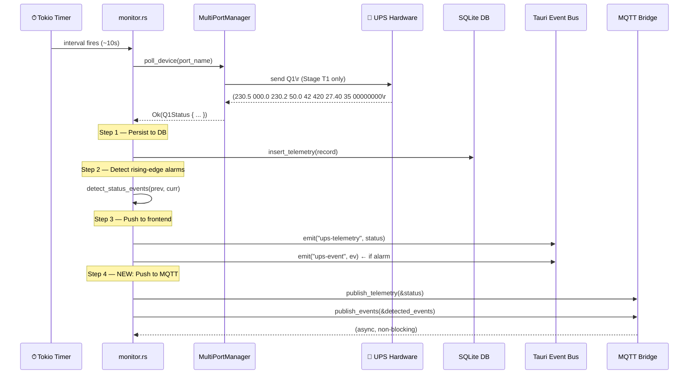

> [!NOTE]
> The MQTT publish in step 4 is **fire-and-forget async** — it never blocks the poll cycle. If the MQTT broker is unreachable, the poll cycle continues normally. Errors are logged but don't affect UPS monitoring.

---

## 3. MQTT Connection Lifecycle

This shows how the `MqttBridge` manages its own connection to the broker independently of the UPS poll cycle.

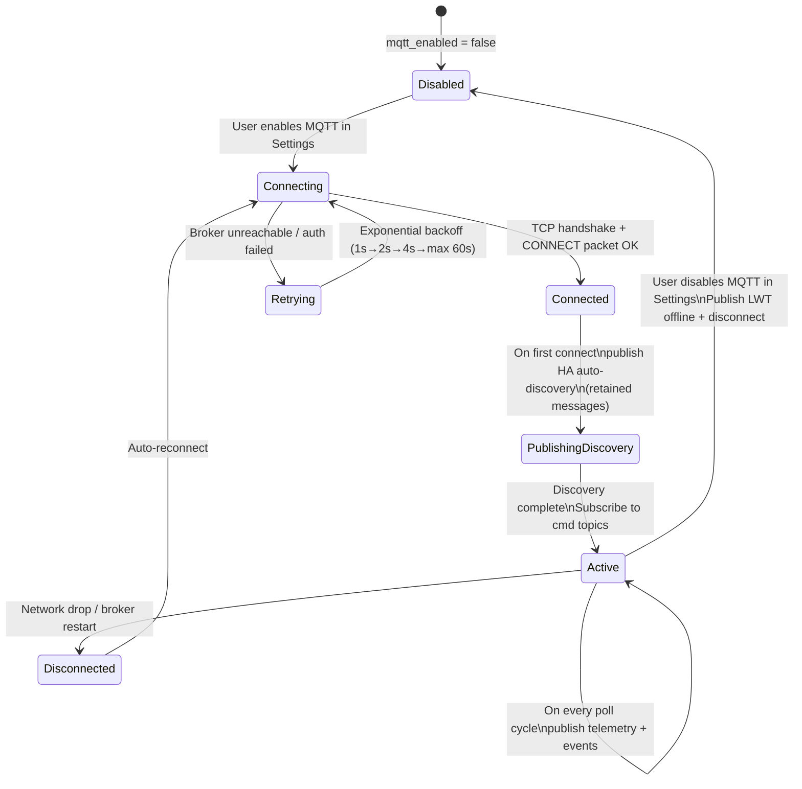

### Last Will & Testament (LWT)

When UPSED sets up the MQTT connection, it registers a **LWT message** with the broker. If UPSED crashes, closes, or loses connectivity without a clean disconnect, the broker automatically publishes:

```
Topic:   upsed/availability
Payload: offline
Retain:  true
```

This causes all 11 HA entities to show **Unavailable** in the HA dashboard instantly — no stale data, no ghost sensors.

---

## 4. Home Assistant Integration — Step by Step

### Step A: Auto-Discovery Handshake

The moment UPSED connects to Mosquitto, it publishes **retained** JSON configs to HA's discovery prefix. HA processes these and creates the entities automatically.

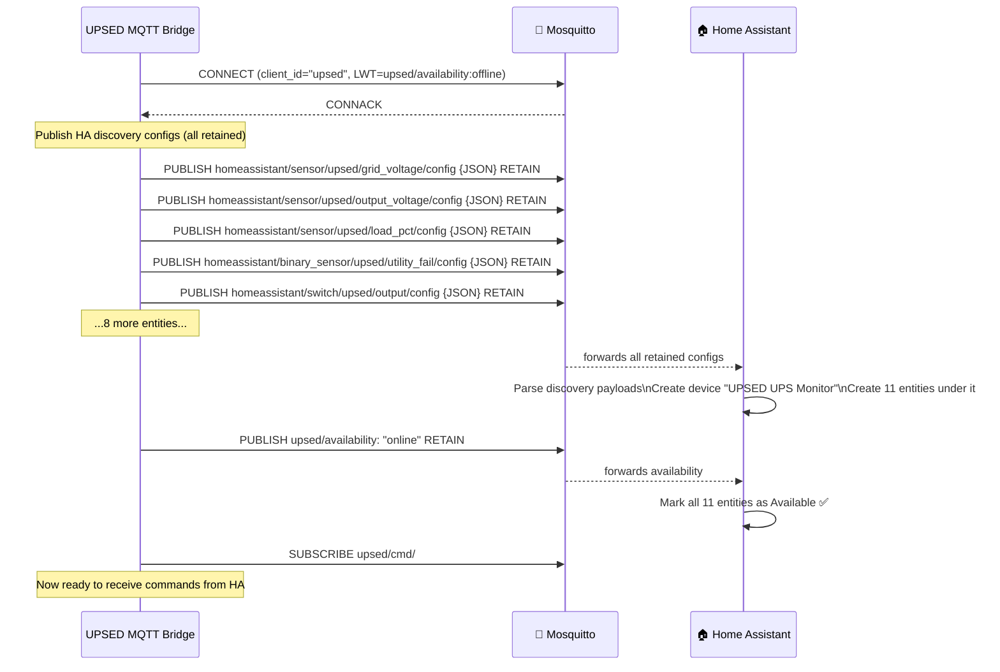

### Step B: Each Discovery Payload in Full

**Example — Grid Voltage sensor** (`homeassistant/sensor/upsed/grid_voltage_v/config`):
```json
{
  "name": "UPS Grid Voltage",
  "unique_id": "upsed_grid_voltage_v",
  "object_id": "upsed_grid_voltage",
  "state_topic": "upsed/telemetry/grid_voltage_v",
  "unit_of_measurement": "V",
  "device_class": "voltage",
  "state_class": "measurement",
  "availability_topic": "upsed/availability",
  "payload_available": "online",
  "payload_not_available": "offline",
  "device": {
    "identifiers": ["upsed_ups_monitor"],
    "name": "UPSED UPS Monitor",
    "model": "Voltronic Axpert / Megatec",
    "manufacturer": "Voltronic Power",
    "sw_version": "1.0.0",
    "configuration_url": "http://localhost:1420"
  }
}
```

**Example — Utility Fail binary_sensor** (`homeassistant/binary_sensor/upsed/utility_fail/config`):
```json
{
  "name": "UPS Utility Fail",
  "unique_id": "upsed_utility_fail",
  "state_topic": "upsed/status/utility_fail",
  "payload_on": "ON",
  "payload_off": "OFF",
  "device_class": "power",
  "availability_topic": "upsed/availability",
  "device": { "identifiers": ["upsed_ups_monitor"] }
}
```

**Example — Output Switch** (`homeassistant/switch/upsed/output/config`):
```json
{
  "name": "UPS Output",
  "unique_id": "upsed_output_switch",
  "state_topic": "upsed/status/output_on",
  "command_topic": "upsed/cmd/output_on",
  "payload_on": "ON",
  "payload_off": "OFF",
  "icon": "mdi:power-socket",
  "availability_topic": "upsed/availability",
  "device": { "identifiers": ["upsed_ups_monitor"] }
}
```

### Step C: Live Telemetry Flow (Every Poll Cycle)

```
UPSED poll resolves → Q1Status { grid_voltage_v: 231.2, load_pct: 38, ... }
     │
     ├─ DB insert           (as today)
     ├─ Tauri emit          (as today → React frontend)
     └─ MQTT publish (NEW):
          upsed/telemetry/grid_voltage_v    →  "231.2"
          upsed/telemetry/output_voltage_v  →  "230.8"
          upsed/telemetry/load_pct          →  "38"
          upsed/telemetry/battery_voltage_v →  "27.4"
          upsed/telemetry/temperature_c     →  "35"
          upsed/telemetry/output_watts      →  "380"
          upsed/status/utility_fail         →  "OFF"
          upsed/status/battery_low          →  "OFF"
          upsed/status/bypass_active        →  "OFF"
          upsed/status/ups_failed           →  "OFF"
          upsed/telemetry/json              →  { all fields as JSON }
```

HA sensors update immediately. Recharts in UPSED frontend also update — both in sync.

---

## 5. The Automation — Your Presence Use Case

Here is exactly how the "walk into room → UPS turns on → PC turns on" automation would work end to end:

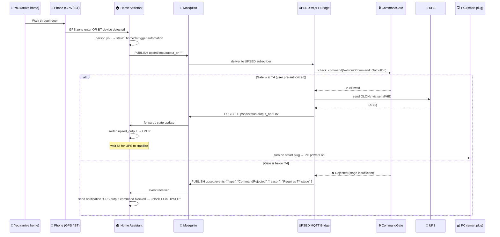

### The HA Automation YAML

```yaml
alias: "Presence: Turn on UPS + PC when arriving"
description: "When you arrive home, turn on UPS output, then power on the PC"
trigger:
  - platform: state
    entity_id: person.you
    to: "home"
condition:
  - condition: state
    entity_id: binary_sensor.upsed_utility_fail
    state: "OFF"        # Grid power must be present
  - condition: state
    entity_id: binary_sensor.upsed_battery_low
    state: "OFF"        # Battery must not be critically low
action:
  - service: mqtt.publish
    data:
      topic: upsed/cmd/output_on
      payload: ""
  - delay: "00:00:05"
  - service: switch.turn_on
    target:
      entity_id: switch.room_pc_plug    # Your Tuya/Zigbee smart plug
  - service: notify.mobile_app
    data:
      message: "UPS and PC turned on. Welcome home! 🏠"
mode: single
```

---

## 6. Tuya TuyaLink — ESP32-S3 Direct TLS 8883 Controller & Cold Boot Workflow

### One-Time Setup (Tuya IoT Developer Platform)

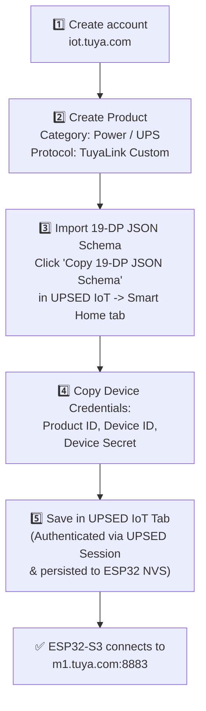

### 19-Property TuyaLink Things Data Model (DPs)

The ESP32-S3 firmware (`upsed-bridge/include/tuya_mqtt.h`) publishes and subscribes to a standardized 19-DP model at `tylink/{device_id}/thing/property/report` and `tylink/{device_id}/thing/property/set`:

| Category | DP Identifier | Type | Access | Hardware Mapping |
| :--- | :--- | :--- | :--- | :--- |
| **Power & Boot** | `ups_power_switch` | `bool` | R/W | `true` $\rightarrow$ `SON\r`; `false` $\rightarrow$ `SOFF\r` or `S.2\r` (guarded by Smart Load/Host Interlock) |
| **Power & Boot** | `force_shutdown` | `bool` | R/W | Bypasses Load/Host Interlock and immediately dispatches `SOFF\r` or `S.2\r` |
| **Power & Boot** | `cancel_shutdown` | `bool` | R/W | Dispatches `CS\r` to abort an active UPS shutdown countdown |
| **Power & Boot** | `output_enabled` | `bool` | R | `true` when `output_voltage >= 80V` |
| **Power & Boot** | `pc_online` | `bool` | R | `true` when UPSED Desktop is connected (`MODE_PROXY`) or `load_pct > interlock_pct` |
| **Telemetry** | `grid_voltage` | `float` | R | Input AC grid voltage (`V`) |
| **Telemetry** | `output_voltage` | `float` | R | Output AC voltage (`V`) |
| **Telemetry** | `load_pct` | `int` | R | Output load percentage (`0–100%`) |
| **Telemetry** | `battery_pct` | `int` | R | Estimated battery SoC (`0–100%`) |
| **Telemetry** | `battery_voltage` | `float` | R | Raw DC battery voltage (`V`) |
| **Telemetry** | `temperature_c` | `float` | R | Internal heatsink temperature (`°C`) |
| **Telemetry** | `ups_mode` | `enum` | R | `"standby"`, `"line"`, `"battery"`, `"bypass"`, `"fault"` |
| **Telemetry** | `utility_fail` | `bool` | R | `Q1` Bit 7 (`true` = Grid Outage / On Battery) |
| **Telemetry** | `battery_low` | `bool` | R | `Q1` Bit 6 (`true` = Critical Low Battery) |
| **Diagnostics** | `buzzer_mute` | `bool` | R/W | Synced with `Q1` Bit 0; writing dispatches `Q\r` |
| **Diagnostics** | `battery_test_10s` | `bool` | R/W | Writing `true` dispatches `T\r` (10s self-test) |
| **Diagnostics** | `deep_battery_test` | `bool` | R/W | Writing `true` dispatches `TL\r` (deep battery test) |
| **Diagnostics** | `cancel_test` | `bool` | R/W | Writing `true` dispatches `CT\r` |
| **Outlets** | `outlet_1_switch` / `outlet_2_switch` | `bool` | R/W | Dispatches `SKON1`/`SKOFF1` and `SKON2`/`SKOFF2` |

### Single-Tap Cold Boot Automation (Tuya Smart Plug + UPSED Bridge)

Because the ESP32-S3 connects directly to TuyaLink MQTT over Wi-Fi (`Port 8883`), you can orchestrate an upstream **Tuya Smart Plug** and the **UPSED ESP32-S3 Bridge** using native Tuya Smart Life Scene timers:
1. **Step 1 (Smart Plug):** Turn ON upstream Smart Plug (applies 230V/120V AC mains to UPS input).
2. **Step 2 (Tuya Scene Delay):** Wait `5s` for the UPS MCU to initialize on AC mains.
3. **Step 3 (UPSED Bridge):** Set `ups_power_switch = true` (ESP32 dispatches `SON\r` to energize UPS inverter and AC output).
4. **Step 4 (Equipment Power):** Connected loads (PC, server, networking gear) receive clean regulated AC power. Workstations configured for "Restore on AC Power Loss" boot immediately.

### TuyaLink Authentication (ESP32 Hardware `mbedtls` HMAC-SHA256)

The ESP32-S3 synchronizes epoch time via NTP (`pool.ntp.org`) and computes the TuyaLink signature using hardware SHA-256 (`mbedtls_md_hmac`):

```
clientId  = "tuyalink_" + DeviceID
username  = DeviceID + "|signMethod=hmacSha256,timestamp=" + <epoch_sec> + ",secureMode=1,accessType=1"
password  = hex(HMAC-SHA256(key=DeviceSecret, data="deviceId=" + DeviceID + ",timestamp=" + <epoch_sec> + ",secureMode=1,accessType=1"))
```

---

## 7. Inbound Command Security — CommandGate Always Wins

This is the most critical safety invariant. **Every** inbound MQTT command, whether from Home Assistant or Tuya, flows through the same `CommandGate` that guards the physical serial port.

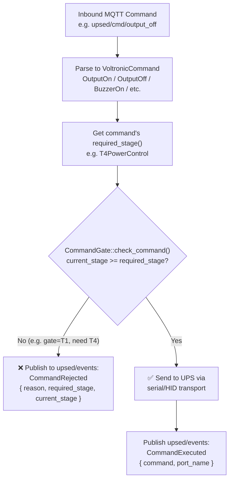

### Stage Requirements per MQTT Command

| MQTT Topic | VoltronicCommand | Required Stage | Risk Level |
|---|---|---|---|
| `upsed/cmd/buzzer_on` | `BuzzerOn` | T2 NonDestructive | 🟡 Low |
| `upsed/cmd/buzzer_off` | `BuzzerOff` | T2 NonDestructive | 🟡 Low |
| `upsed/cmd/battery_test` | `BatteryTest` | T2 NonDestructive | 🟡 Medium |
| `upsed/cmd/cancel_test` | `CancelTest` | T2 NonDestructive | 🟡 Low |
| `upsed/cmd/output_on` | `OutputOn` | **T4 PowerControl** | 🔴 High |
| `upsed/cmd/output_off` | `OutputOff` | **T4 PowerControl** | 🔴 High |
| `upsed/cmd/shutdown` | `Shutdown` | **T4 PowerControl** | 🔴 High |

> [!CAUTION]
> **The gate is never auto-elevated by MQTT.** Even if the Smart Life app sends an `output_off` command, it will be silently rejected with a CommandRejected event if the UPSED user hasn't explicitly unlocked T4 in the desktop app first. This is deliberate — it prevents rogue automations or compromised MQTT brokers from cutting power unexpectedly.

---

## 8. Settings UI — What the User Sees

A new **"IoT Bridges"** tab in the UPSED Settings view. All values persist to SQLite `settings` table.

### Section 1 — Home Assistant / MQTT

```
┌──────────────────────────────────────────────────┐
│  🏠 Home Assistant / MQTT                         │
│                                                  │
│  Enable MQTT Bridge          [ ● OFF ]  → [ ON ] │
│                                                  │
│  Broker Host      [ localhost           ]        │
│  Broker Port      [ 1883   ]                     │
│  Username         [         ]  (optional)        │
│  Password         [ ········ ]  (optional)       │
│  TLS / SSL        [ ○ OFF ]                      │
│                                                  │
│  Topic Prefix     [ upsed   ]                    │
│  HA Auto-Discovery [ ● ON ]                      │
│                                                  │
│  Status:  ● Connected to localhost:1883          │
│           11 entities registered in HA           │
│           Last publish: 3s ago                   │
│                             [ Test Connection ]  │
└──────────────────────────────────────────────────┘
```

### Section 2 — Tuya Smart Life

```
┌──────────────────────────────────────────────────┐
│  ☁️ Tuya Smart Life (TuyaLink)                    │
│                                                  │
│  Enable Tuya Bridge          [ ○ OFF ]           │
│                                                  │
│  Product ID       [ abc123xyz       ]            │
│  Device ID        [ vdev_xxxxxx     ]            │
│  Device Secret    [ ················ ]           │
│                                                  │
│  Status:  ○ Not connected                        │
│                  [ How to get credentials? ]     │
└──────────────────────────────────────────────────┘
```

---

## 9. Code Structure — What Gets Added

### New files

```
src-tauri/src/mqtt/
├── mod.rs          ← MqttBridge struct, start(), stop(), publish_telemetry(), publish_events()
├── config.rs       ← MqttConfig { host, port, user, pass, tls, prefix, ha_discovery, ... }
├── ha_discovery.rs ← build_sensor_config(), build_binary_sensor_config(), publish_all_discovery()
└── tuya_link.rs    ← TuyaAuth, hmac_sign(), build_report_payload(), handle_set_command()
```

### Modified files

| File | What Changes |
|---|---|
| [`src-tauri/Cargo.toml`](file:///c:/Users/adsan/Documents/My%20Projects/Projects/Desktop%20App%20Development/UPSED/src-tauri/Cargo.toml) | Add `rumqttc = "0.24"`, `hmac`, `sha2` crates |
| [`src-tauri/src/lib.rs`](file:///c:/Users/adsan/Documents/My%20Projects/Projects/Desktop%20App%20Development/UPSED/src-tauri/src/lib.rs) | `pub mod mqtt;`, register new Tauri commands, add `mqtt_bridge` to `AppState` |
| [`src-tauri/src/commands.rs`](file:///c:/Users/adsan/Documents/My%20Projects/Projects/Desktop%20App%20Development/UPSED/src-tauri/src/commands.rs) | Add `AppState.mqtt_bridge` field; new Tauri commands `get_mqtt_config`, `set_mqtt_config`, `get_mqtt_status` |
| [`src-tauri/src/monitor.rs`](file:///c:/Users/adsan/Documents/My%20Projects/Projects/Desktop%20App%20Development/UPSED/src-tauri/src/monitor.rs) | In `poll_cycle_step`: call `mqtt_bridge.publish_telemetry()` + `publish_events()` after DB insert |
| [`src/lib/types.ts`](file:///c:/Users/adsan/Documents/My%20Projects/Projects/Desktop%20App%20Development/UPSED/src/lib/types.ts) | Add `MqttConfig`, `MqttStatus` TypeScript interfaces |
| `src/views/Settings.tsx` | Add "IoT Bridges" tab with HA + Tuya config forms |

### New test file

```
src-tauri/tests/mqtt_tests.rs
├── test_ha_discovery_payload_structure
├── test_telemetry_publish_topic_format
├── test_t4_command_rejected_below_gate
├── test_t4_command_accepted_at_gate
├── test_t2_command_accepted_at_t2
├── test_lwt_offline_on_disconnect
└── test_tuya_dp_integer_scaling
```

---

## 10. End-to-End Sequence — Full "Walk In the Door" Flow

Putting it all together:

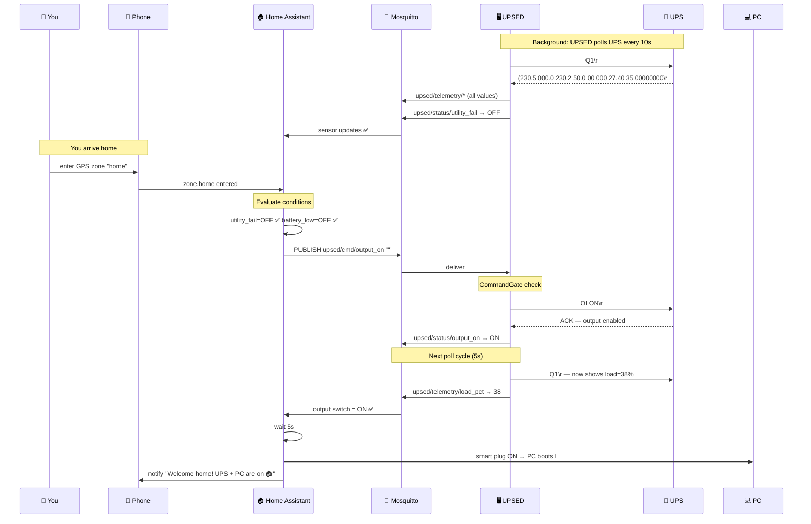

---

## 11. What You Need to Set Up (One-Time Checklist)

### Local Network
- [ ] Install **Mosquitto** on your PC or HA server: `choco install mosquitto` or via HA Add-ons
- [ ] Install **Home Assistant** (HAOS, Docker, or HA Core)
- [ ] In HA: install the **MQTT Integration** (Settings → Devices & Services → Add Integration → MQTT)
- [ ] Point HA MQTT integration to the same Mosquitto broker

### UPSED Settings
- [ ] Open UPSED → Settings → IoT Bridges
- [ ] Enable MQTT Bridge, enter broker host/port
- [ ] Click "Test Connection" → confirm green status
- [ ] Verify HA shows a new device "UPSED UPS Monitor" with 11 entities

### Tuya (optional)
- [ ] Create account at [iot.tuya.com](https://iot.tuya.com/)
- [ ] Create TuyaLink product, define TDM, copy credentials
- [ ] Enter credentials in UPSED → Settings → IoT Bridges → Tuya
- [ ] Open Smart Life app → Add Device → "Manually Added Devices" → enter credentials

### Home Assistant
- [ ] Create the presence automation (YAML above or via UI Automation editor)
- [ ] Test with Developer Tools → MQTT → Publish `upsed/cmd/output_on` manually
- [ ] Verify UPS responds (T4 gate must be unlocked in UPSED first)

---

> [!TIP]
> **Local-first recommendation**: Run Mosquitto directly on the same Windows PC as UPSED. UPSED connects to `localhost:1883`, Home Assistant connects over your LAN to `192.168.x.x:1883`. Zero cloud dependency for the HA integration path. Tuya remains the only cloud-dependent path.

---

---

# Part 2 — UPSED Bridge (ESP32 Hardware Extension)

> **Codename:** UPSED Bridge — a first-party hardware companion to UPSED. An ESP32-based IoT bridge that ensures the UPS is always connected to your smart home, even when the PC is completely off.

---

## 12. The Problem UPSED Bridge Solves

The Phase 1 MQTT integration (built into UPSED) is fully functional — **but only while the PC is running.** The moment Windows shuts down, the UPS becomes invisible to Home Assistant and Tuya.

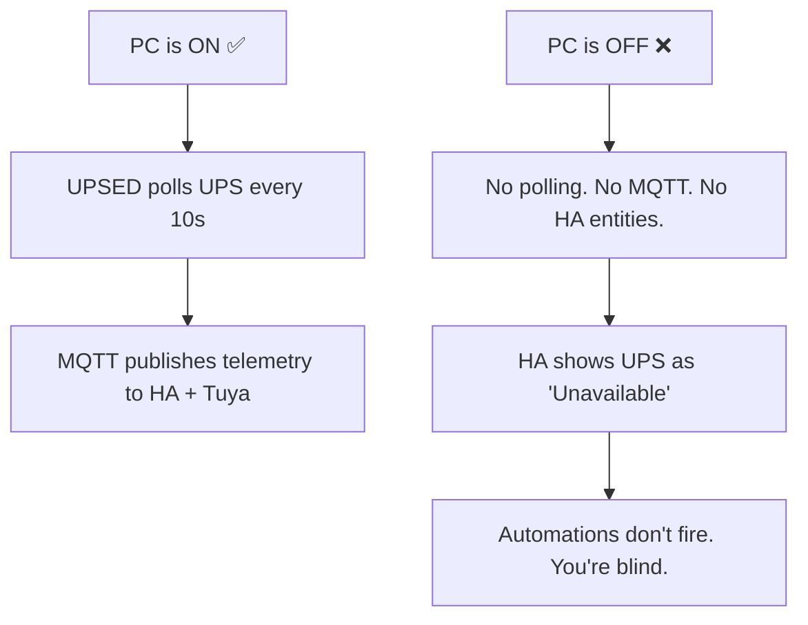

**The scenarios where this matters:**
- You shut down your PC for the night — UPS disconnects from HA
- PC crashes — UPS disappears from automation
- Power outage shuts down PC — HA loses UPS sensor right when it matters most
- UPS battery drains and shuts down the PC — telemetry stops right at the critical moment

---

## 13. UPSED Bridge — Architecture Overview

### Hardware Options: Baseline ESP32-S3 vs. Low-Cost ESP32-S / OLED
The architecture supports two deployment tiers depending on availability and budget:
* **Gold Standard (ESP32-S3 DevKitC-1 N16R8):** Dual-core LX7 @ 240MHz, 16MB Flash, 8MB PSRAM, Native USB CDC (driverless plug-and-play), 60+ days offline data retention.
* **Low-Cost Baseline (NodeMCU ESP32-S Narrow / Type-C OLED):** Dual-core LX6 @ 240MHz, 4MB Flash, integrated antenna, 2–4 days offline telemetry. Features an optional 0.96" OLED screen for physical real-time status without opening an app.

### Verified Hardware Invariant from Manufacturer Manual
> [!CAUTION]
> **"USB port and RS-232 port can’t work at the same time."**  
> Voltronic UPS mainboards multiplex the rear USB Type-B port and RS-232 port to the **same internal microcontroller UART**. Connecting both simultaneously causes electrical bus contention and frame corruption.  
> **Rule:** The rear USB Type-B port must remain **unplugged**. The ESP32 connects solely to the **RS-232 port** via the MAX3232 transceiver.

### Physical Wiring & Dual-Mode Connectivity Topology

```
┌────────────────────────────────────────────────────────────────────────┐
│                                                                        │
│   🔋 Voltronic UPS                                                     │
│   ┌────────────────┐                                                   │
│   │  RS-232 Port   │───────────────────────────────┐                  │
│   │  (±12V Logic)  │                               │                  │
│   │  USB Port (B)  │  [MUST REMAIN UNPLUGGED]      │                  │
│   │  Intelligent   │  [LEAVE COVERED - NO POWER]   │                  │
│   └────────────────┘                               │                  │
│                                                    │                  │
│                         ┌──────────────────────┐   │                  │
│                         │ MAX3232 Level Shifter│◄──┘ (RS-232 DB9)     │
│                         │ (3.3V ↔ ±12V Logic)  │                      │
│                         └──────────┬───────────┘                      │
│                                    │ 3.3V UART (TX/RX)                │
│                                    ▼                                  │
│   ┌────────────────────────────────────────────────────────────────┐  │
│   │ ESP32 Bridge (NodeMCU ESP32-S or ESP32-S3)                     │  │
│   │                                                                │  │
│   │   GPIO18 (UART2 TX) ◄───────── MAX3232 ROUT (UPS TX)           │  │
│   │   GPIO17 (UART2 RX) ──────────► MAX3232 TIN  (UPS RX)          │  │
│   │                                                                │  │
│   │   [POWER INPUT OPTIONS - 5V DC]:                               │  │
│   │   Option A: Mini in-line 5V battery buffer on PC USB cable     │  │
│   │   Option B: Step-down buck (12V/24V → 5V) from UPS battery     │  │
│   │                                                                │  │
│   │   [PC LINK OPTIONS]:                                           │  │
│   │   • Wired: USB Cable (Native CDC on S3 or CH340 on ESP32-S)    │  │
│   │   • Wireless: Local Wi-Fi WebSocket (ws://ip:8080) / TCP       │  │
│   │   • Wireless: Bluetooth Serial (SPP Virtual COM Port)          │  │
│   │                                                                │  │
│   │   Wi-Fi (Built-in PCB Antenna) ──────────► Home Assistant/Tuya │  │
│   └────────────────────────────────────────────────────────────────┘  │
│                                                                        │
└────────────────────────────────────────────────────────────────────────┘
```

**Continuous 24/7 Power Architecture:**
* The rear AC sockets cut power when the UPS inverter is switched off.
* The rear USB Type-B port is a power sink (0V output).
* The Intelligent Slot requires custom PCB edge connectors and risks bus shorts.
* **Verified Continuous Power Solutions:**
  1. **In-line 5V Battery Buffer (Recommended Non-Invasive):** A single 18650 cell module with pass-through charging placed between the PC USB and ESP32. Charges while PC is on, provides 20–30+ hours of continuous power when PC and UPS are turned off.
  2. **Direct Battery Buck Tap (Recommended Permanent):** An MP1584EN buck converter stepping internal 12V/24V battery voltage down to 5V.

**Wired or 100% Wireless PC Operation:**
Because the ESP32 handles Wi-Fi and Bluetooth, a physical USB cable to the PC is only needed for the initial 30-second bootstrap firmware flash. After that, UPSED can connect to the bridge over **Local Wi-Fi WebSocket/TCP** or **Bluetooth Serial (Virtual COM)**, allowing the UPS to be placed anywhere in the room.

> [!IMPORTANT]
> The ESP32 is the **sole UART master** to the UPS at all times. UPSED never touches the UPS serial port directly — it communicates with the ESP32 (wirelessly or via USB pipe). This eliminates all serial arbitration conflicts.


---

## 14. The Role Handoff State Machine

The ESP32 runs a deterministic state machine with two modes:

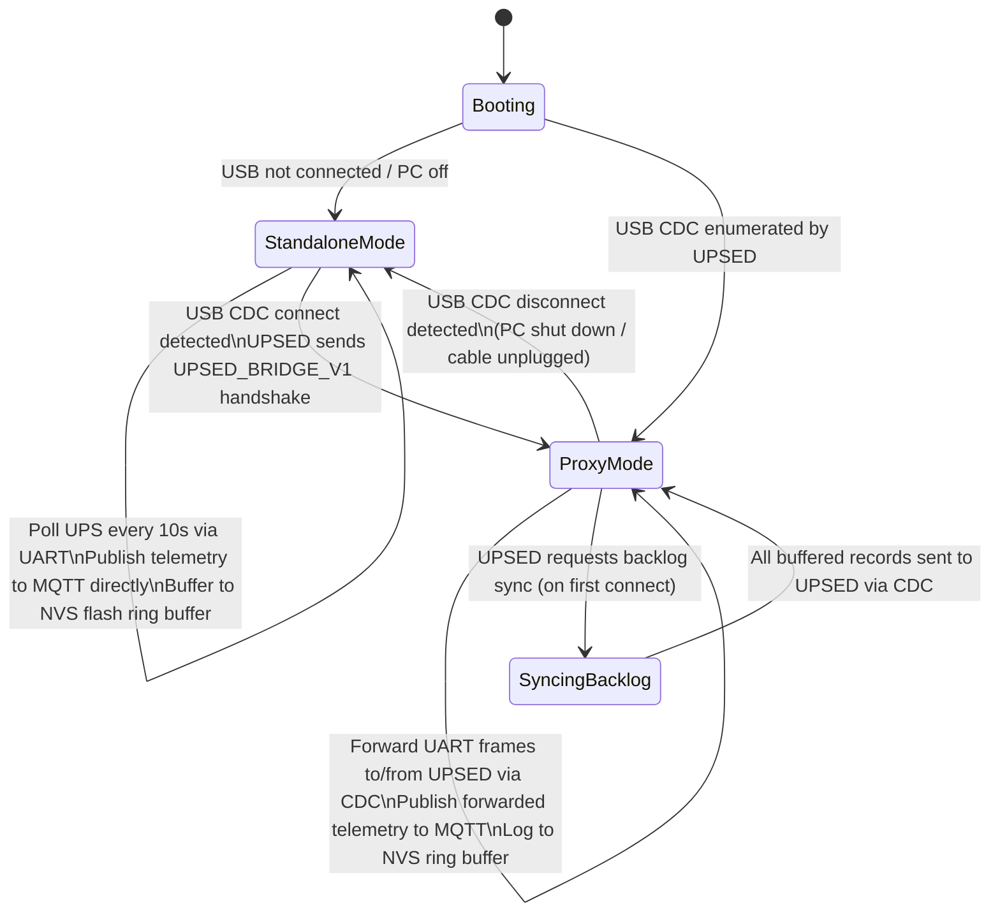

### Mode Details

| Aspect | Proxy Mode (PC ON) | Standalone Mode (PC OFF) |
|---|---|---|
| Who polls UPS | UPSED (via ESP32 CDC pipe) | ESP32 directly via UART |
| MQTT publisher | ESP32 (from forwarded data) | ESP32 (from direct poll) |
| Topics published | Same `upsed/telemetry/*` | Same `upsed/telemetry/*` |
| HA sees difference | None — seamless handoff | None — seamless handoff |
| NVS buffering | Yes (for outage coverage) | Yes (main store) |
| Inbound commands | Forwarded to UPSED → CommandGate | ESP32 executes directly (T1 only\*) |

> [!IMPORTANT]
> **Standalone Mode & Smart Load/Host Safety Interlock:** When the PC is off (`MODE_STANDALONE`), the ESP32-S3 allows TuyaLink MQTT to turn the UPS **ON** (`SON\r`) so Cold Boot scenes can energize the UPS before waking the PC. Conversely, turning the UPS **OFF** via `ups_power_switch = false` is guarded by the ESP32's local **Smart Load & Host Interlock**: if UPSED Desktop is connected (`MODE_PROXY`) or `load_pct > interlock_pct` (default `8%`), the ESP32 blocks the power-off request to prevent accidental power loss to a running PC (unless explicitly overridden via the `force_shutdown` DP).

---

## 15. Identification Handshake Protocol

When UPSED detects a new COM port on startup or hot-plug, the scanner already probes with `QPI\r`. The UPSED Bridge modifies this slightly:

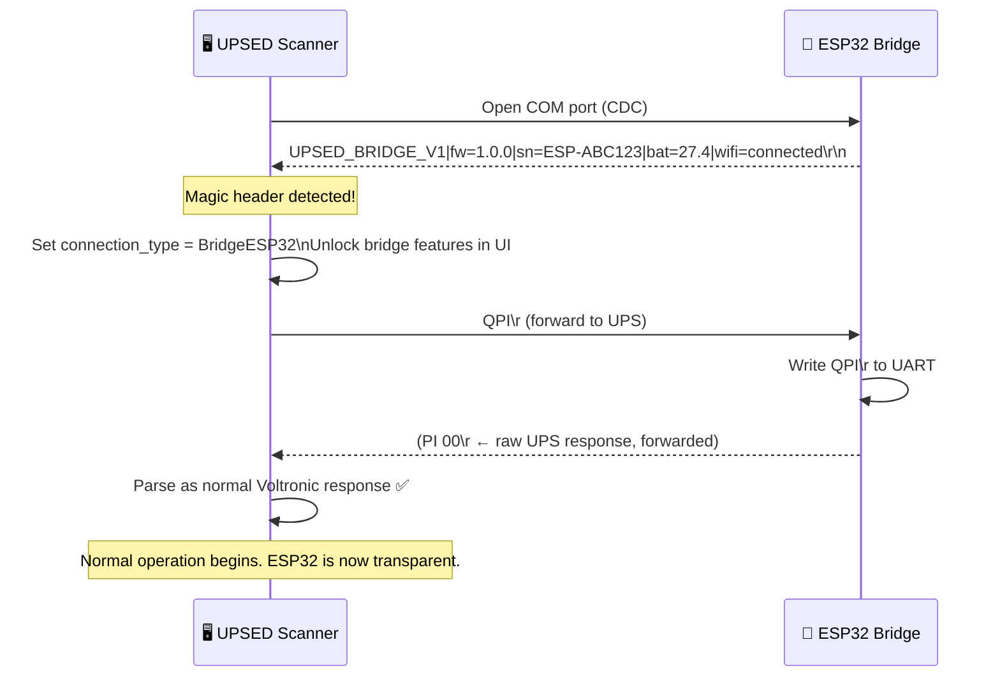

**Magic header format:**
```
UPSED_BRIDGE_V1|fw=<version>|sn=<esp_chip_id>|bat=<last_bat_v>|wifi=<connected|disconnected>
```

This gives UPSED:
1. Confirmation it's talking to a UPSED Bridge (not a raw UPS serial port)
2. Current ESP32 firmware version (for OTA comparison)
3. ESP32 chip serial (for device identification)
4. Last known battery voltage (pre-handshake standalone telemetry)
5. WiFi/MQTT connectivity status

---

## 16. Configuration Push — UPSED → ESP32

All ESP32 configuration is done from the UPSED Settings UI. No web portal, no manual flashing of credentials. When the user saves settings, UPSED sends a JSON config packet over USB CDC:

```json
{
  "cmd": "SET_CONFIG",
  "wifi_ssid": "HomeNetwork",
  "wifi_password": "••••••••",
  "mqtt_host": "192.168.1.100",
  "mqtt_port": 1883,
  "mqtt_user": "upsed",
  "mqtt_password": "••••••••",
  "mqtt_topic_prefix": "upsed",
  "mqtt_tls": false,
  "poll_interval_secs": 10,
  "tuya_enabled": true,
  "tuya_product_id": "abc123",
  "tuya_device_id": "vdev_xxx",
  "tuya_device_secret": "••••••••"
}
```

ESP32 responds:
```json
{ "cmd": "SET_CONFIG_ACK", "status": "ok" }
```

And stores all values in **NVS flash** (ESP-IDF's non-volatile storage). The credentials survive reboots and power cuts.

---

## 17. Backlog Sync — Recovering Offline Telemetry (16MB Flash + 8MB PSRAM)

When the PC boots after being powered off (overnight, during a prolonged blackout, or during a multi-day trip), UPSED requests all offline telemetry collected by the ESP32-S3 in Standalone Mode.

### 24-Byte Packed Binary Telemetry Record
Instead of slow, bandwidth-heavy JSON, the ESP32-S3 writes records in a memory-aligned **24-byte packed binary struct**:

```c
struct __attribute__((packed)) TelemetryRecordSample {
    uint32_t timestamp_epoch;    // 4B: Unix epoch seconds (valid through 2106)
    uint16_t grid_voltage_deci;   // 2B: Grid Volts × 10 (e.g. 2305 = 230.5V)
    uint16_t output_voltage_deci; // 2B: Output Volts × 10 (e.g. 2302 = 230.2V)
    uint16_t grid_freq_deci;      // 2B: Grid Frequency × 10 (e.g. 500 = 50.0 Hz)
    uint16_t output_freq_deci;    // 2B: Output Frequency × 10
    uint16_t output_watts;        // 2B: Real active load (0 - 65,535 W)
    uint16_t battery_voltage_cent;// 2B: Battery Volts × 100 (e.g. 2740 = 27.40V)
    uint8_t  output_load_pct;     // 1B: Percentage load (0 - 100%)
    int8_t   temperature_c;       // 1B: Internal heatsink temp (-40 to +125 °C)
    uint16_t status_flags;        // 2B: Bitmask (utility_fail, bat_low, bypass, fault)
    uint16_t checksum;            // 2B: Fletcher-16 / CRC16 integrity check
}; // Total exact size = 24 bytes
```

### Two-Tier Storage Engine: PSRAM + 16MB Flash Partition
The ESP32-S3 baseline provides an unmatched storage hierarchy:
1. **Tier 1 — 4 MB PSRAM Circular Buffer (Zero Flash Wear):**
   * Holds **174,700 records** in high-speed RAM.
   * Completely immune to flash write endurance limits.
   * As long as the UPS USB port maintains 5V power, data lives in zero-latency RAM.
2. **Tier 2 — 8 MB Dedicated Flash Partition (`telemetry_log`):**
   * Formatted as a circular wear-leveled ring buffer.
   * Records are accumulated in a 4 KB RAM sector buffer (170 samples = ~28 minutes) and committed to flash in single sector writes.
   * **Calculated Endurance:** Over 25 years of continuous non-stop writes before sector wear.

### Offline Retention Capacity

| Polling Interval | Daily Ingestion | PSRAM Capacity (4MB) | Dedicated Flash Capacity (8MB) | **Total Unbroken Retention** |
| :--- | :--- | :--- | :--- | :--- |
| **10 Seconds** (Default) | 8,640 records (~207 KB/day) | **~20.2 Days** (174,700 samples) | **~40.4 Days** (349,500 samples) | **~60.6 Days (2+ Months)** |
| **5 Seconds** (High-Res) | 17,280 records (~414 KB/day)| **~10.1 Days** (174,700 samples) | **~20.2 Days** (349,500 samples) | **~30.3 Days (1 Month)** |

### High-Speed Backlog Sync Sequence (Over Native USB CDC)
Over native USB CDC (Full-Speed 12 Mbps), binary bulk transfer synchronizes thousands of samples in a fraction of a second:

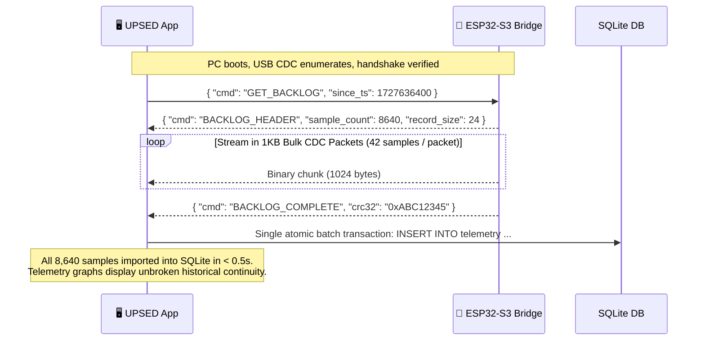

---

## 18. OTA Firmware Updates — UPSED → ESP32

The "Update Firmware" button in UPSED Settings:

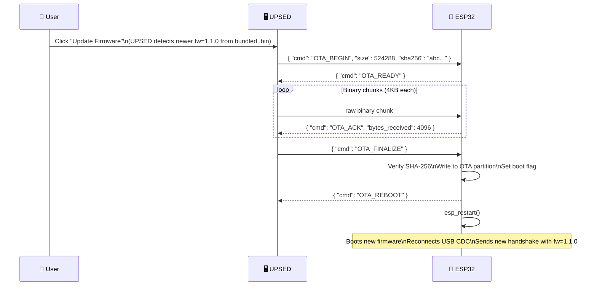

UPSED bundles the latest `upsed_bridge.bin` in its own release (inside `resources/`). When the app updates, the bridge firmware updates too.

---

## 19. Power Continuity & Blackout Survival

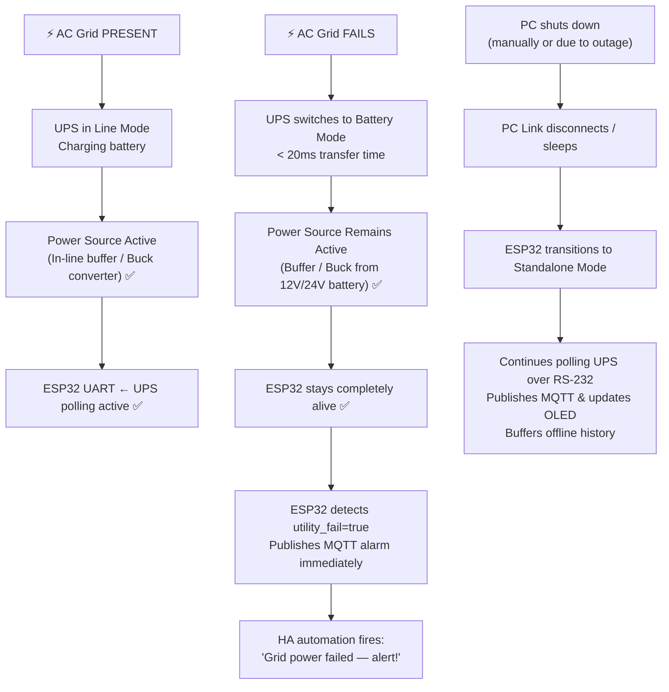

**Key Invariant on Power:**
* The UPS's rear USB Type-B port is a client device port and **outputs 0V**.
* The UPS AC sockets cut out when the UPS inverter is powered off.
* To achieve true 24/7 independence regardless of UPS inverter power state, power is supplied either via:
  1. An **in-line 5V battery buffer module** on the PC USB line (holding charge for 20–30+ hours of standalone operation).
  2. A **direct DC-DC step-down buck converter (MP1584EN)** wired to the internal 12V/24V battery spade terminals.

**The critical scenario — power outage while PC is on:**
1. Grid fails → UPS switches to battery in <20ms
2. ESP32 immediately publishes `utility_fail=ON` to MQTT
3. HA automation fires: notify phone, turn off non-essential devices
4. PC runs on UPS battery for ~X minutes
5. UPS battery gets low → UPSED gets `battery_low` signal → triggers graceful PC shutdown
6. PC shuts down → USB CDC disconnects → ESP32 goes Standalone
7. **ESP32 continues publishing battery drain telemetry to HA until UPS is completely dead**
8. When grid restores → ESP32 publishes `utility_fail=OFF` → HA knows grid is back
9. PC can be auto-powered on (via smart plug) when grid is confirmed stable

---

## 20. Full Revised Architecture — With UPSED Bridge

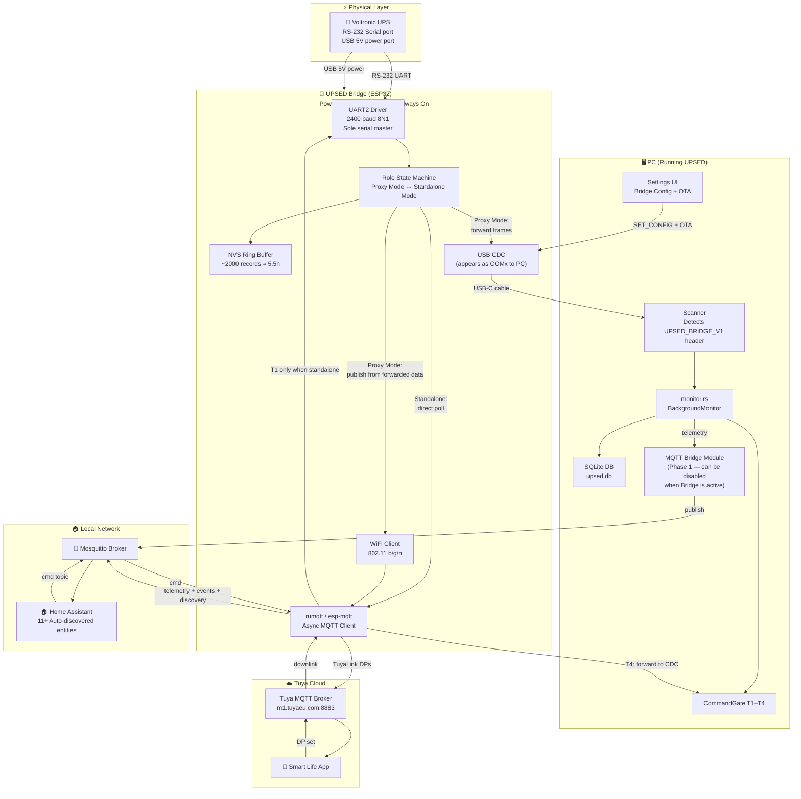

---

## 21. UPSED Bridge — Firmware Architecture (ESP-IDF v5.2+)

Standardized on the **ESP32-S3-WROOM-1-N16R8** with Octal Flash and Octal PSRAM.

### Partition Table Layout (`partitions_16mb.csv`)
```csv
# Name,            Type, SubType, Offset,   Size,     Flags
nvs,               data, nvs,     0x9000,   0x10000,
otadata,           data, ota,     0x19000,  0x2000,
phy_init,          data, phy,     0x1b000,  0x1000,
ota_0,             app,  ota_0,   0x20000,  0x300000, # 3.0 MB App partition A
ota_1,             app,  ota_1,   0x320000, 0x300000, # 3.0 MB App partition B
telemetry_ring,    data, 0x82,    0x620000, 0x800000, # 8.0 MB Dedicated wear-leveled flash log
storage_config,    data, spiffs,  0xe20000, 0x1d0000, # 1.8 MB LittleFS / Web / Certs
```

### ESP-IDF Configuration (`sdkconfig.defaults`)
```ini
# ESP32-S3 System & Clock
CONFIG_IDF_TARGET="esp32s3"=y
CONFIG_ESP32S3_DEFAULT_CPU_FREQ_240=y

# 8MB Octal PSRAM Configuration
CONFIG_SPIRAM=y
CONFIG_SPIRAM_MODE_OCT=y
CONFIG_SPIRAM_SPEED_80M=y
CONFIG_SPIRAM_USE_MALLOC=y
CONFIG_SPIRAM_MEMTEST=y

# Native On-Chip USB CDC (TinyUSB)
CONFIG_ESP_CONSOLE_USB_CDC=y
CONFIG_TINYUSB=y
CONFIG_TINYUSB_CDC_ENABLED=y
CONFIG_TINYUSB_DESC_CUSTOM_STRING=y
CONFIG_TINYUSB_DESC_MANUFACTURER_STRING="UPSED Hardware"
CONFIG_TINYUSB_DESC_PRODUCT_STRING="UPSED Native Bridge"
CONFIG_TINYUSB_DESC_SERIAL_STRING="UPSED-S3-N16R8"
```

### Firmware Directory Structure
```
upsed-bridge/                         ← Companion firmware repository
├── CMakeLists.txt
├── partitions_16mb.csv               ← 16MB dual-OTA + 8MB telemetry partition
├── sdkconfig.defaults                ← Octal PSRAM + Native USB CDC enabled
├── main/
│   ├── CMakeLists.txt
│   ├── main.c                        ← app_main(), PSRAM validation, FreeRTOS task launch
│   ├── state_machine.c               ← Role handoff: Proxy Mode ↔ Standalone Mode
│   ├── ups_uart.c                    ← UART2 driver (GPIO17 RX, GPIO18 TX @ 2400/9600 baud)
│   ├── cdc_handler.c                 ← Native USB CDC pipe, UPSED_BRIDGE_V1 handshake, bulk sync
│   ├── psram_buffer.c                ← 4MB circular ring buffer in fast Octal PSRAM
│   ├── flash_logger.c                ← 8MB flash partition wear-leveling & periodic 4KB flush
│   ├── mqtt_client.c                 ← esp-mqtt client (TCP/TLS), HA discovery publisher
│   ├── tuya_link.c                   ← TuyaLink HMAC-SHA256 signature generator & DP mapping
│   ├── config_store.c                ← NVS-backed credential management (Wi-Fi, MQTT, Tuya)
│   └── ota_cdc_receiver.c            ← High-speed native USB binary chunk receiver (12 Mbps)
└── components/
    └── max3232_transceiver/          ← Hardware abstraction for RS-232 level shifter
```

### FreeRTOS Dual-Core Task Allocation

| Task | Core | Priority | Stack | Functionality |
|---|---|---|---|---|
| `ups_uart_task` | Core 0 | High (12) | 4 KB | Dedicated UART2 listener; strictly owns physical UPS serial bus |
| `cdc_handler_task` | Core 1 | High (10) | 8 KB | Native USB CDC worker; manages high-throughput UPSED pipe |
| `state_machine_task`| Core 0 | Med (6)  | 4 KB | Monitors VBUS/USB enumeration; orchestrates Proxy ↔ Standalone |
| `psram_ring_task`  | Core 0 | Med (5)  | 4 KB | Manages 174,000-sample RAM circular buffer |
| `flash_flush_task` | Core 0 | Low (2)  | 4 KB | Flushes 4KB sector buffers to flash partition every ~28 minutes |
| `mqtt_worker_task` | Core 1 | Med (6)  | 8 KB | Maintains TCP connection, publishes telemetry & handles command topics |
| `wifi_mgr_task`    | Core 1 | Low (3)  | 4 KB | Wi-Fi 802.11 b/g/n link monitoring and exponential backoff reconnect |

---

## 22. UPSED Settings UI — Bridge Section

```
┌────────────────────────────────────────────────────────────────────────┐
│  🔌 UPSED Hardware Bridge                         [● Connected - Native]│
│                                                                        │
│  Board Hardware      ESP32-S3 DevKitC-1 N16R8 (Xtensa LX7 @ 240MHz)     │
│  Firmware Version    v1.0.0-s3               [Update Firmware (USB) ▲]  │
│  Connection Bus      Native USB CDC (Full-Speed 12 Mbps, Driver-Free)  │
│  Operating Mode      ● Proxy Mode (PC Primary)                          │
│                                                                        │
│  ── Memory & Telemetry Retention ────────────────────────────────────  │
│  Fast PSRAM Buffer   4 MB Active (174,700 samples available)            │
│  Persistent Flash    8 MB Dedicated Partition (349,500 samples capacity)│
│  Retention Coverage  ~60.6 Days unbroken offline logging (@ 10s poll)   │
│  Offline Backlog     8,640 records pending sync       [Sync Now (0.4s)]│
│                                                                        │
│  ── Wireless & Cloud Link ───────────────────────────────────────────  │
│  Wi-Fi Connection    ● Connected (HomeNetwork_5G - RSSI: -48 dBm)      │
│  Home Assistant MQTT ● Online (192.168.1.100:1883)                     │
│  Tuya Smart Life     ● Cloud Linked (TDM Mode: TuyaLink)               │
│                                                                        │
│  ── Bridge Configuration ────────────────────────────────────────────  │
│  Wi-Fi SSID          [ HomeNetwork_2.4G       ]                        │
│  Wi-Fi Password      [ ························]                        │
│  MQTT Broker IP/Host [ 192.168.1.100          ]  Port: [ 1883 ]         │
│  MQTT Credentials    User: [ upsed   ]   Pass: [ ········ ]            │
│  Standby Polling     [ 10 ] seconds                                    │
│                                           [ Push Config to Hardware ]  │
└────────────────────────────────────────────────────────────────────────┘
```

---

## 23. Implementation Phases — Updated

| Phase | Milestone | Deliverable |
|---|---|---|
| **Phase 1** | Pure Software MQTT Module | `src-tauri/src/mqtt/` (Local HA Discovery & Tuya via PC desktop) |
| **Phase 2** | Native USB CDC Bridge Driver | Scanner auto-identifies `UPSED-S3-N16R8` USB VID/PID & magic handshake |
| **Phase 3** | Desktop Bridge Management UI | Backlog sync protocol, binary OTA push & Settings UI integration |
| **Phase 4** | ESP-IDF S3 Core Engine | State machine, UART2 driver, 8MB Octal PSRAM ring buffer, Native CDC pipe |
| **Phase 5** | Standalone S3 Networking | Embedded `esp-mqtt` client, Wi-Fi manager & local HA discovery engine |
| **Phase 6** | Flash Wear-Leveling Logger | 8MB dedicated partition writer with 4KB sector buffering |
| **Phase 7** | Full Integration Verification | 60-day backlog stress test, blackout handoff test, T4 command gate verification |

---

## 24. Hardware Shopping List

| Component | Specification | Purpose | Approx. Cost |
|---|---|---|---|
| **MCU Board (Option A - S3)** | **ESP32-S3 DevKitC-1 N16R8** (Dual Type-C, Native CDC, 16MB Flash, 8MB PSRAM) | Enterprise gold standard: 60-day logging, driverless | **~2,050 LKR** (~$7 USD) |
| **MCU Board (Option B - S/OLED)** | **NodeMCU ESP32-S Narrow** or **Type-C with 0.96" OLED Display** | Low-cost entry baseline: Real-time desk OLED screen, Wi-Fi/BLE, 2–4 days log | **~1,550 – 1,950 LKR** (~$5–6.50 USD) |
| **MAX3232 Module** | 3.3V to 5V RS-232 Breakout with charge pump capacitors | Converts ESP32 3.3V UART to UPS ±12V serial levels | **~350 LKR** (~$1.20 USD) |
| **DB9 Female to 3-Pin Cable** | Standard DB9 female with TX, RX, GND leads | Connects MAX3232 to UPS RS-232 port | **~300 LKR** (~$1.00 USD) |
| **Power Solution (Option 1)** | **In-line 5V USB Battery Buffer Module (18650)** with power-path | Keeps ESP32 running 24/7 when PC & UPS are powered off | **~400 – 600 LKR** (~$1.50–2.00 USD) |
| **Power Solution (Option 2)** | **MP1584EN DC-DC Buck Converter** (Input 7–28V, Output 5V) | Direct permanent tap to internal 12V/24V battery | **~250 LKR** (~$0.80 USD) |
| **Breadboard & Jumper Wires** | 830-point breadboard + male-to-female Dupont jumpers | Prototype wiring harness | **~450 LKR** (~$1.50 USD) |

---

## 25. One-Time Setup Checklist

- [ ] **Hardware Interconnect:**
  - Connect MAX3232 `ROUT` → ESP32 `GPIO17` (UART2 RX).
  - Connect MAX3232 `TIN` → ESP32 `GPIO18` (UART2 TX).
  - Connect MAX3232 `VCC` → ESP32 `3.3V` pin; MAX3232 `GND` → ESP32 `GND`.
  - Connect DB9 port to UPS RS-232 port.
  - **Leave UPS USB Type-B port unplugged** (do not connect both USB and RS-232 simultaneously).
  - Power the ESP32 via the in-line battery buffer or DC buck converter.
- [ ] **Initial Bootstrap Flash:**
  - Connect PC to ESP32 via USB.
  - Flash firmware using PlatformIO / ESP-IDF (initial bootstrap only).
- [ ] **PC Link Configuration (Wired or Wireless):**
  - **Wired:** Connect USB cable to PC (driverless on S3, or install CH340/CP2102 once on ESP32-S).
  - **Wireless Alternative:** Connect UPSED to the ESP32's local IP address (`ws://192.168.x.x:8080`) or via paired Bluetooth Serial virtual COM port.
- [ ] **Configuration via UPSED:**
  - Open UPSED desktop app → navigate to **Settings → Bridge**.
  - Enter Wi-Fi and MQTT credentials → click **Push Config to Hardware**.
  - Bridge connects to Home Assistant / Tuya immediately.
- [ ] **Validation Experiments:**
  - Verify all 11 entities are auto-discovered in Home Assistant.
  - Turn off UPS inverter output → verify ESP32 stays alive on battery buffer and reports outage state to Home Assistant.
  - Test BLE proximity detection: verify walk-in room entry triggers instant UPS turn-on automation.

---

## 26. ESP32 Hardware Status LED Reference (WS2812 RGB)

The ESP32-S3 firmware drives an onboard addressable WS2812 RGB LED (primary GPIO 48, secondary GPIO 38) via a non-blocking, priority-ranked state engine running at ~60 Hz. Below is the operational reference:

| Priority | Pattern & Color | Operating State | Trigger Condition & Description |
| :---: | :--- | :--- | :--- |
| **P1A** | 🟣 **Blinking Magenta** (200ms ON / 200ms OFF) | **OTA Authentication / Staged Lease** | `ArduinoOTA` UDP invite received / PBKDF2 authentication in flight on port 3232, or 90-second HTTP OTA lease active on port 8080 awaiting upload token. |
| **P1B** | 🟣 **Pulsing Magenta** (800ms breathing wave) | **Active Firmware Streaming** | Active firmware binary chunk transmission and flash write in progress over Wi-Fi (`espota` port 3232 or HTTP port 8080). Synchronously updated on every flash write chunk. |
| **P1C** | 🟢 **Solid Green Flash** (250ms) | **OTA Flashing Complete** | Firmware committed cleanly to flash partition without checksum errors. Bridge rebooting into newly flashed firmware. |
| **P2** | 🔴 **Pulsing Alert Red** (700ms pulse) | **AC Power Outage · On Battery** | **CRITICAL:** Utility Fail bit active (`Q1` / `QPIGS`). Mains power lost and UPS inverter supplying load from battery. |
| **P3** | 🔴 **Fast Double-Blink Red** (1.2s cycle) | **Wi-Fi Auth Error (`AUTH_FAIL`)** | Incorrect Wi-Fi credentials or router AP rejected association (Reason 202). Check network credentials. |
| **P3** | 🟠 **Slow Blinking Amber** (1s cycle: 500ms ON / 500ms OFF) | **Wi-Fi Disconnected** | Wi-Fi association lost. Device performing periodic automatic reconnect attempts every 30 seconds. |
| **P3** | 🟠 **Pulsing Amber** (900ms pulse) | **Wi-Fi Associating / Booting** | Actively associating with configured 2.4GHz Wi-Fi AP and requesting DHCP IP assignment. |
| **P4** | 🔵 **Momentary Blue Flash** (60ms tick) | **Serial Bus Activity** | Dispatched during `MODE_PROXY` whenever a serial query or command is executed against the UPS. |
| **P4** | 🟢 **Momentary Mint/White Flash** (80ms tick) | **Tuya Telemetry Published** | Rendered each time a 19-DP telemetry snapshot report is successfully delivered to TuyaLink MQTT. |
| **P4** | 🟣 **Periodic Violet Pulse** (450ms every 3s) | **Tuya Connecting / Syncing** | Overlaid on base mode while acquiring NTP time, resolving broker DNS, or establishing TLS handshake. |
| **P4** | 🟠 **Periodic Orange Double-Blink** (every 3s) | **Tuya Fault / Auth Error** | Overlaid on base mode when TuyaLink connection drops or credentials rejected (`rc=4`/`rc=5`). Reconnecting with exponential backoff. |
| **P5** | 🟢 **Solid Green** | **Proxy Mode (Normal)** | Fully operational. AC grid healthy, UPS RS-232 communicating, UPSED desktop connected via WebSocket / USB CDC. |
| **P5** | 🟡 **Pulsing Yellow** (1.5s pulse) | **Proxy Mode · UPS Offline / NAK** | Desktop connected, but UPS RS-232 cable disconnected or UPS returning `NAK`. |
| **P6** | 🔷 **Breathing Cyan** (2.4s pulse) | **Standalone Logging Mode** | UPSED desktop offline (>15s silence). Bridge autonomously buffering telemetry snapshots to 8MB PSRAM ring buffer. |
| **P6** | 🟡 **Slow Amber/Yellow Pulse** (1.8s pulse) | **Standalone · UPS Offline / NAK** | Desktop offline AND UPS RS-232 cable disconnected or returning `NAK`. |

