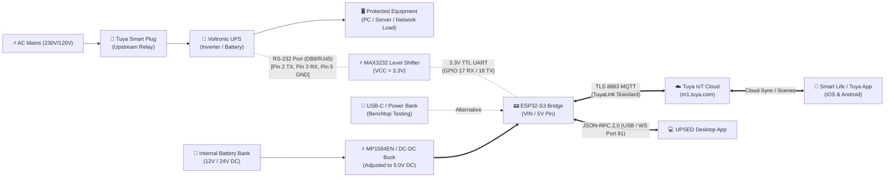
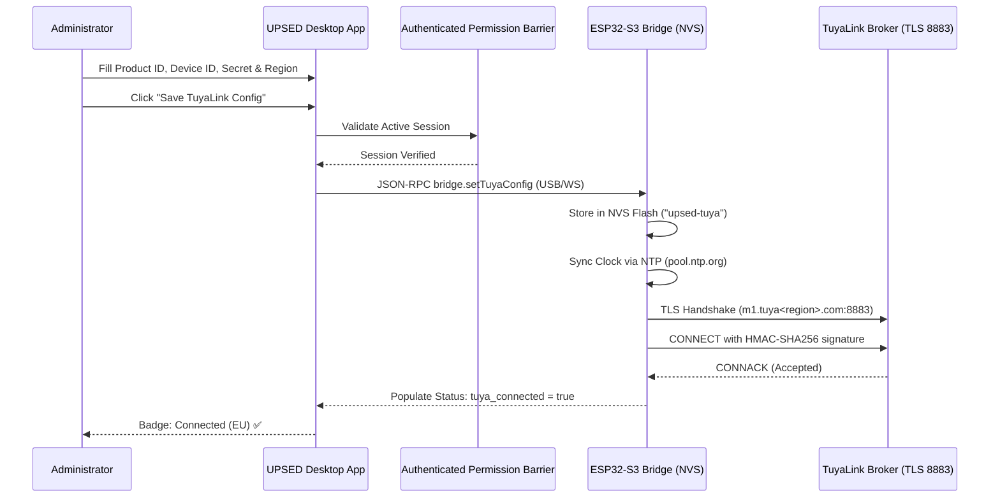
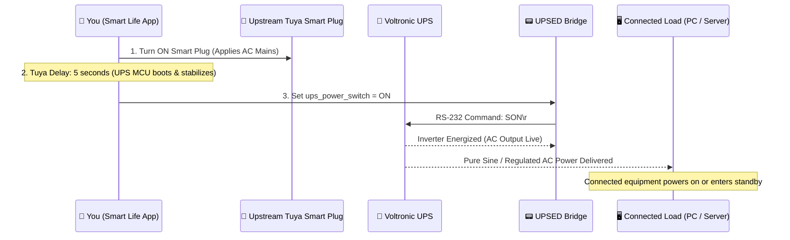

# UPSED — Complete Tuya Smart & TuyaLink Integration Guide

This guide provides an end-to-end operational walkthrough for integrating your **Voltronic / Megatec UPS**, the **UPSED ESP32-S3 IoT Bridge**, the **UPSED Desktop Application**, and the **Tuya IoT Cloud Platform** to orchestrate seamless smart home power automation—including single-tap cold boot, remote inverter control, and load-protected shutdown with an upstream **Tuya Smart Plug** and your connected workstation or server load.

---

## 🧭 Table of Contents
1. [Architecture & Hardware Interconnection](#1-architecture--hardware-interconnection)
2. [Pre-Flight Data Center Audit (Critical Region Rule)](#2-pre-flight-data-center-audit-critical-region-rule)
3. [Tuya IoT Developer Console Walkthrough](#3-tuya-iot-developer-console-walkthrough)
   - [Step A: Create the TuyaLink Product](#step-a-create-the-tuyalink-product)
   - [Step B: Define the Things Data Model (Data Points)](#step-b-define-the-things-data-model-data-points)
   - [Step C: Claim & Assign Free Developer Licenses](#step-c-claim--assign-free-developer-licenses)
   - [Step D: Register the Hardware Device](#step-d-register-the-hardware-device)
   - [Step E: Link the Smart Life Mobile App (Cloud Project Method)](#step-e-link-the-smart-life-mobile-app-cloud-project-method)
4. [UPSED Bridge & Desktop App Provisioning](#4-upsed-bridge--desktop-app-provisioning)
5. [Smart Life Automation Recipes](#5-smart-life-automation-recipes)
   - [Recipe 1: Single-Tap Cold Boot from Off](#recipe-1-single-tap-cold-boot-from-off)
   - [Recipe 2: Wake from Sleep (S3 / Hibernate)](#recipe-2-wake-from-sleep-s3--hibernate)
   - [Recipe 3: Smart Load & Host Safety Interlock](#recipe-3-smart-load--host-safety-interlock)
6. [Complete 19-DP Things Data Model Reference](#6-complete-19-dp-things-data-model-reference)
7. [Diagnostic & Troubleshooting Playbook](#7-diagnostic--troubleshooting-playbook)

---

## 1. Architecture & Hardware Interconnection



### Critical Hardware Rules & Wiring Specifications

#### 1. Bridge Power Supply Architecture
* **Testing & Bench Phase:** Power the ESP32-S3 via a standard USB-C cable or external power bank.
* **Production Deployment:** Connect an **MP1584EN** or **LM2596HV** DC-DC step-down buck module directly to the UPS internal battery bank terminals (+12V or +24V DC).
  * Adjust the buck module's potentiometer to **exactly 5.0V DC** before connecting to the ESP32.
  * Connect Buck Output `+5V` to ESP32 `VIN` (or `5V`), and Buck `GND` to ESP32 `GND`.
  * *Why this is mandatory:* If you power the ESP32 from the UPS rear AC backup outlets, turning off the UPS output or smart plug will cut power to the bridge. Once the ESP32 loses power, it cannot receive Tuya MQTT commands to boot the system! Operating directly from the battery bank draws negligible current (~60–90mA) and guarantees 24/7 cloud connectivity.

#### 2. RS-232 Level Shifter Invariant (MAX3232 at 3.3V)
> [!CAUTION]
> **Power MAX3232 VCC Strictly from 3.3V, NOT 5V!**
> The Voltronic RS-232 port operates at true bipolar $\pm12\text{V}$ signaling. Connecting directly to the ESP32 GPIOs will permanently destroy the microcontroller.
> When connecting the MAX3232 breakout board:
> - **VCC** $\rightarrow$ Connect to ESP32 **3V3** pin (NOT 5V! When VCC is 5V, the TTL outputs are 5V, which can degrade or burn the ESP32 3.3V CMOS GPIOs).
> - **GND** $\rightarrow$ Connect to ESP32 **GND**.
> - **TXD (TTL)** $\rightarrow$ Connect to ESP32 **GPIO 18** (TX).
> - **RXD (TTL)** $\rightarrow$ Connect to ESP32 **GPIO 17** (RX).
> - **RS-232 DB9 / RJ45 Connector:**
>   - DB9 Pin 2 (RS-232 RX) $\rightarrow$ Connect to UPS Serial TXD.
>   - DB9 Pin 3 (RS-232 TX) $\rightarrow$ Connect to UPS Serial RXD.
>   - DB9 Pin 5 (GND) $\rightarrow$ Connect to UPS Ground.

#### 3. Physical Port Exclusivity Invariant
Never connect the UPS rear USB Type-B port and RS-232 port simultaneously; both interfaces are multiplexed to the same internal microcontroller UART and will cause electrical contention and corrupted frames.

#### 4. Tuya Smart Plug Relay Status
Configure your upstream Tuya Smart Plug in the Smart Life app under **Relay Status / Power-on State** to **"Remember last status"** (or **"ON"**). This ensures that if utility mains flickers, the smart plug retains its expected state automatically without getting stuck in a default OFF state.

---

## 2. Pre-Flight Data Center Audit (Critical Region Rule)

> [!CAUTION]
> **The #1 Cause of Setup Failure (`rc=5` and "Data centers inconsistency"):**
> Tuya enforces strict data segregation. A device registered in one data center **cannot** be controlled by an account in another data center on Tuya's free developer tier.

Tuya automatically assigns user accounts to a specific data center based on the **country code of the phone number or region selected when creating the Smart Life account**:

| Account Country / Region | Phone Code | Assigned Tuya Data Center | Regional MQTT Broker |
| :--- | :--- | :--- | :--- |
| **Sri Lanka** | `+94` | **Central Europe Data Center** | `m1.tuyaeu.com:8883` |
| **Europe & UK** | `+44`, `+49`, `+33`, etc. | **Central Europe Data Center** | `m1.tuyaeu.com:8883` |
| **Middle East & Africa** | `+971`, `+20`, `+27`, etc. | **Central Europe Data Center** | `m1.tuyaeu.com:8883` |
| **India** | `+91` | **India Data Center** | `m1.tuyain.com:8883` |
| **United States & Americas** | `+1`, `+52`, `+55`, etc. | **Western America Data Center** | `m1.tuyaus.com:8883` |
| **Mainland China** | `+86` | **China Data Center** | `m1.tuyacn.com:8883` |

### How to Verify Your Mobile App Region:
1. Open the **Smart Life** (or **Tuya Smart**) app on your phone.
2. Tap **Me** (bottom right) $\rightarrow$ tap the **Settings icon** (gear, top right) $\rightarrow$ tap **Account and Security**.
3. Look at the **Region** field at the bottom.
4. **Rule:** Your Tuya Developer Console top-right dropdown, your Cloud Project, your Device Registration, and the UPSED Desktop Region setting **MUST ALL MATCH THIS EXACT DATA CENTER**!

---

## 3. Tuya IoT Developer Console Walkthrough

### Step A: Create the TuyaLink Product
1. Log in to the [Tuya IoT Developer Platform](https://iot.tuya.com).
2. In the top-right corner, ensure your Data Center matches your pre-flight audit (e.g., **Central Europe Data Center** for Sri Lanka).
3. Navigate to **Product** $\rightarrow$ **Development** $\rightarrow$ click **Create Product**.
4. Configure product parameters:
   - **Category:** *Electrical* $\rightarrow$ *Power Strip* (or *Energy* $\rightarrow$ *UPS*)
   - **Smart Solution:** Select **TuyaLink**
   - **Product Name:** `UPSED Bridge`
   - **Product Model:** `ESP32-S3-UPS`
   - **Device Type:** **Common Device** *(Default)*
   - **Data Protocol:** **Tuya Standard Protocol** *(Default)*
   - **Protocol:** Select **Wi-Fi** (or *Wi-Fi and Bluetooth Combo*)
5. Click **Create**. Copy down your **Product ID (PID)** (e.g., `rcpbn2trru83ctjr`).

---

### Step B: Define the Things Data Model (Data Points)

You can import all 19 Data Points automatically in **5 seconds** using Tuya's Batch Import template, or add them manually:

#### Method 1: Instant Batch Import via CSV / Excel (Recommended)
1. In the UPSED Desktop App, navigate to **IoT** $\rightarrow$ **Smart Home** tab.
2. Click **Download Tuya Batch CSV** (or copy [`docs/tuya_upsed_bridge_dps.csv`](file:///Users/sandakannipunajith/Documents/Developments/Projects/UPSED/docs/tuya_upsed_bridge_dps.csv) from your repository).
3. In the Tuya Developer Console under your **UPSED Bridge** product, open the **Function Definition** tab.
4. Click **Import / Export** (or **Batch Add / Batch Import**) $\rightarrow$ select **Import via Template / Excel**.
5. Upload the downloaded `tuya_upsed_bridge_dps.csv`.
6. Tuya will validate and create all 19 DPs (`101` through `120`) in one click!

#### Method 2: Manual Custom Functions
If you prefer adding functions individually, scroll to **Custom Functions** $\rightarrow$ click **`+ Add`**:

1. **UPS Power Switch (Required for Cold Boot & Inverter Control):**
   - **DP ID:** `101`
   - **Function Name:** `UPS Power Switch`
   - **Identifier:** `ups_power_switch` *(must match exactly, lowercase)*
   - **Function Type:** `Property`
   - **Data Type:** `Bool`
   - **Data Transfer Type:** `Send and Report` (Read-Write)
   - Click **OK**.

2. **AC Output Status (Recommended for State Verification):**
   - Click **`+ Add`**
   - **Function Name:** `AC Output Status`
   - **Identifier:** `output_enabled`
   - **Function Type:** `Property`
   - **Data Type:** `Bool`
   - **Data Transfer Type:** `Report Only` (Read-Only)
   - Click **OK**.

*(For the complete table of all 19 Data Points including voltage, battery percentage, and diagnostics, refer to [Section 6](#6-complete-19-dp-things-data-model-reference)).*

---

### Step C: Claim & Assign Free Developer Licenses
Every TuyaLink device requires an authorization license. Tuya provides **2 free trial licenses ($0.00)** per data center for development:

1. In the Tuya Developer Console top menu, click **Purchase** (or go to **Cloud** $\rightarrow$ **Authorization Code**).
2. Select your aligned Data Center (e.g., **Central Europe Data Center**).
3. Click **Get Free Trial / Order Free License** ($0.00, Quantity: 2).
4. Click **Assign to Product** $\rightarrow$ assign `1` license to your **`UPSED Bridge`** product.

---

### Step D: Register the Hardware Device
1. Return to your product page (**UPSED Bridge**) $\rightarrow$ select the **Device Management** tab.
2. Confirm the dropdown at the top shows your aligned Data Center (e.g., **Central Europe Data Center**).
3. Click **Register Device**:
   - Verify `data center` displays your correct region.
   - Verify `Remaining license` displays `1pcs` (or `2pcs`).
   - In **RegistrationID**, type: `upsed-bridge-01` (or leave blank).
   - Click **OK**.
4. A new row will appear in your device list. Copy:
   - **Device ID** (e.g., `26a17f12573350b64fjlkp`)
   - **Device Secret** (click the eye or copy icon to copy the HMAC key)

---

### Step E: Link the Smart Life Mobile App (Cloud Project Method)

> [!IMPORTANT]
> **Do not scan the device list "QR Code Binding" directly!**
> Scanning the table's QR code triggers an OEM app package download redirect (`https://m-ind.smart321.com/...`) resulting in *"package not found"*. Linking to the standard consumer **Smart Life** app must be done via a **Cloud Project**.

1. In the far-left dark navigation bar of the Tuya Developer Platform, click **Cloud** $\rightarrow$ **Development**.
2. Click **Create Cloud Project**:
   - **Project Name:** `UPSED Home`
   - **Industry / Method:** Select **Smart Home**
   - **Data Center:** Select your aligned data center (**Central Europe Data Center**)
   - Click **Create** $\rightarrow$ keep default authorization services $\rightarrow$ click **Authorize**.
3. Inside your new Cloud Project:
   - Click the **Devices** tab at the top.
   - Click the **Link Tuya App Account** sub-tab.
   - Click **Add App Account**.
4. An account authorization QR code will appear on your computer monitor.
5. On your phone:
   - Open the **Smart Life** app.
   - Tap **Me** (bottom right) $\rightarrow$ tap the **QR Scanner icon** (top right corner).
   - Scan the QR code on your computer screen $\rightarrow$ tap **Confirm Authorization**.
6. The Smart Life app account will now be linked to your cloud project. All devices registered under your developer account will automatically sync into your phone!

---

## 4. UPSED Bridge & Desktop App Provisioning

With the credentials in hand, configure the ESP32-S3 bridge from the UPSED Desktop App:



1. Open the UPSED Desktop App $\rightarrow$ navigate to the **IoT** page $\rightarrow$ select the **Smart Home** tab.
2. Under **TuyaLink MQTT Cloud Controller**:
   - Check **Enable TuyaLink MQTT**.
   - Select **Tuya Data Center Region**:
     - `Central Europe (m1.tuyaeu.com)` (for Sri Lanka `+94`, Europe, Middle East)
     - `India (m1.tuyain.com)` (for India `+91`)
     - `Western America (m1.tuyaus.com)` (for Americas `+1`)
   - Paste your **Product ID**, **Device ID**, and **Device Secret**.
   - Select **Power-Off Command Mode**:
     - `SOFF` (Standby Off — recommended for Online / P-Series UPS)
     - `S.2` (12-second Delayed Shutdown — recommended for Megatec Line-Interactive UPS)
   - Configure **Smart Load Safety Interlock** (default `8%` — blocks accidental shutoff while PC is running).
3. Click **Save TuyaLink Config**. Authenticate with your administrator password if prompted.
4. The ESP32-S3 saves the configuration to its NVS flash and establishes an encrypted connection.
5. The badge will change to **Connected (EU)** (or your selected region).
6. Click **"Push Telemetry Now"** to verify data transfer.

---

## 5. Smart Life Automation Recipes

### Recipe 1: Single-Tap Cold Boot from Off
**Scenario:** Upstream Smart Plug is OFF, UPS is OFF, connected equipment is unpowered. You tap one button on your phone to energize the mains and power on the UPS inverter.



#### Smart Life Scene Configuration:
1. In the **Smart Life** mobile app, go to **Scene** (bottom menu) $\rightarrow$ **Tap-to-Run** $\rightarrow$ tap **`+`** (Create Scene).
2. Set **Then (Actions)** in this exact sequence:
   - **Action 1:** Select **Smart Plug** $\rightarrow$ Switch = **ON**.
   - **Action 2:** Select **Delay the task** $\rightarrow$ set to **5 seconds** *(allows UPS internal transformers, filter caps, and MCU to initialize on AC mains)*.
   - **Action 3:** Select **UPSED Bridge** $\rightarrow$ **UPS Power Switch** = **ON** *(the ESP32 sends `SON\r` over RS-232 to turn on the UPS inverter and energize output receptacles)*.
3. Save the scene as **"Power On Workstation"** or **"Cold Boot UPS"**.

---

### Recipe 2: Remote Controlled Shutdown
**Scenario:** Workstation or server has completed its workload or cleanly shut down, and you want to turn off the UPS inverter followed by cutting the upstream smart plug.
1. In the **Smart Life** app, set **UPSED Bridge** $\rightarrow$ **UPS Power Switch** = **OFF**.
2. The ESP32 evaluates the **Smart Load Interlock** (see Recipe 3). If load is below the configured threshold (e.g., $<8\%$) and Desktop proxy is inactive, it dispatches `SOFF\r` (or `S.2\r`) over RS-232, powering down the inverter.
3. In a tap-to-run scene, you can optionally chain a 5-second delay followed by **Smart Plug** $\rightarrow$ Switch = **OFF** to completely disconnect AC mains.

---

### Recipe 3: Smart Load & Host Safety Interlock
To protect your workstation against accidental power loss:
- **Turning the UPS ON (`ups_power_switch = true`):** Always permitted at any time.
- **Turning the UPS OFF (`ups_power_switch = false`):** The ESP32 firmware enforces a local **Load and Host Interlock**:
  - If the UPSED Desktop App is actively communicating (`MODE_PROXY`), **OR**
  - If the measured UPS load exceeds the configured threshold (`load_pct > 8%`),
  - **The ESP32 blocks the power-off command** and logs an interlock warning to prevent cutting power to an active computer.
- **Emergency Force Shutdown Override:** If you must cut power remotely regardless of load, send `force_shutdown = true`.

---

## 6. Complete 19-DP Things Data Model Reference

The ESP32 firmware (`upsed-bridge/include/tuya_mqtt.h`) implements the full 19-property TuyaLink data model. You can import all functions into Tuya Developer Platform:

| DP ID | Identifier | Name | Type | Access | Specs / Range | Description |
| :--- | :--- | :--- | :--- | :--- | :--- | :--- |
| **101** | `ups_power_switch` | UPS Power Switch | Bool | R/W | `true` / `false` | Turns UPS output ON (`SON\r`) or OFF (`SOFF\r`/`S.2\r`) |
| **102** | `force_shutdown` | Force Shutdown | Bool | R/W | `true` / `false` | Bypasses safety interlock and immediately powers off output |
| **103** | `cancel_shutdown` | Cancel Shutdown | Bool | R/W | `true` / `false` | Aborts pending hardware shutdown countdown (`CS\r`) |
| **104** | `output_enabled` | AC Output Status | Bool | RO | `true` / `false` | `true` when AC output voltage $\ge 80\text{V}$ |
| **105** | `pc_online` | PC Host Online | Bool | RO | `true` / `false` | `true` when Desktop proxy active or load $> \text{threshold}$ |
| **106** | `grid_voltage` | Grid Voltage | Value | RO | 0–3000, Scale: 1, `V` | Input AC grid voltage |
| **107** | `output_voltage` | Output Voltage | Value | RO | 0–3000, Scale: 1, `V` | Output AC voltage |
| **108** | `load_pct` | Load Percentage | Value | RO | 0–100, Scale: 0, `%` | Real-time output load percentage |
| **109** | `battery_pct` | Battery Percentage | Value | RO | 0–100, Scale: 0, `%` | Estimated battery state-of-charge |
| **110** | `battery_voltage`| Battery Voltage | Value | RO | 0–10000, Scale: 2, `V`| Raw DC battery bank voltage |
| **111** | `temperature_c` | Temperature | Value | RO | 0–1000, Scale: 1, `°C`| Internal heatsink temperature |
| **112** | `ups_mode` | Operating Mode | Enum | RO | `standby`, `line`, `battery`, `bypass`, `fault` | Current UPS operating mode |
| **113** | `utility_fail` | Utility Grid Fail | Bool | RO | `true` / `false` | `true` during blackouts (running on battery) |
| **114** | `battery_low` | Low Battery Alarm | Bool | RO | `true` / `false` | `true` when battery is critically depleted |
| **115** | `buzzer_mute` | Buzzer Mute | Bool | R/W | `true` / `false` | Toggles UPS audible beeper (`Q\r`) |
| **116** | `battery_test_10s`| 10s Battery Test | Bool | R/W | `true` / `false` | Dispatches 10-second battery self-test (`T\r`) |
| **117** | `deep_battery_test`| Deep Battery Test| Bool | R/W | `true` / `false` | Tests battery until low threshold (`TL\r`) |
| **118** | `cancel_test` | Cancel Self-Test | Bool | R/W | `true` / `false` | Cancels active battery test (`CT\r`) |
| **119** | `outlet_1_switch` | Programmable Outlet 1 | Bool | R/W | `true` / `false` | Toggles outlet group 1 (`SKON1`/`SKOFF1`) |
| **120** | `outlet_2_switch` | Programmable Outlet 2 | Bool | R/W | `true` / `false` | Toggles outlet group 2 (`SKON2`/`SKOFF2`) |

---

## 7. Diagnostic & Troubleshooting Playbook

### Symptom 1: `Connection to m1.tuyaeu.com:8883 failed (rc=5)`
- **Meaning:** `MQTT_CONNECT_UNAUTHORIZED` (Credentials or region rejected by broker).
- **Root Cause:** The device was registered in one data center (e.g., India), but UPSED is attempting to connect to another (e.g., Central Europe), or the Device Secret has a typo.
- **Solution:** 
  1. Open Tuya Developer Console $\rightarrow$ check the region where the device was registered.
  2. If registered in Central Europe, make sure UPSED is set to `Central Europe (m1.tuyaeu.com)`.
  3. Re-copy the **Device ID** and **Device Secret** from the console into UPSED and click **Save TuyaLink Config**.

---

### Symptom 2: `"Data centers inconsistency, App account cannot be linked"`
- **Meaning:** Your mobile Smart Life account is hosted in a different data center than your Cloud Project.
- **Root Cause:** A Sri Lankan phone number (`+94`) is mapped to the **Central Europe Data Center** by Tuya. Attempting to link it to an Indian Cloud project triggers this rejection.
- **Solution:** In Tuya Developer Console top-right corner, switch the active data center to **Central Europe Data Center**, create/open your Cloud project there, and scan the QR code.

---

### Symptom 3: Scanning QR Code redirects to `https://m-ind.smart321.com/...` with `"package not found"`
- **Meaning:** The device list QR code is designed for white-label OEM custom apps, not the public Smart Life app.
- **Solution:** Do not scan the QR code under *Device Management* $\rightarrow$ *QR Code Binding*. Instead, link your account via **Cloud** $\rightarrow$ **Development** $\rightarrow$ **Devices** $\rightarrow$ **Link Tuya App Account** as explained in [Step E](#step-e-link-the-smart-life-mobile-app-cloud-project-method).

---

### Symptom 4: PlatformIO Wireless OTA Fails with `Authenticating (MD5 protocol)...FAIL`
- **Meaning:** `espota.py` authentication failed when uploading over Wi-Fi on port 3232.
- **Root Cause:** Missing authentication password flag (`--auth`) during the upload handshake.
- **Solution:**
  1. Verify root `.env` contains `UPSED_OTA_SECRET="your-secret"`.
  2. Verify `upsed-bridge/platformio.ini` includes `extra_scripts = pre:pre_ota.py`.
  3. Run wireless OTA uploads via:
     ```bash
     npm run bridge:ota
     ```
  4. Ensure macOS does not block incoming connections on the ephemeral Python port when prompted by the firewall.

---

### Symptom 5: ESP32 Compiler Warning: `'neopixelWrite' is deprecated`
- **Meaning:** Deprecation warning on ESP32 Arduino Core 2.0.14+ and 3.x.
- **Solution:** `setBridgeLed()` in `upsed-bridge/include/config.h` uses `rgbLedWrite(pin, r, g, b)`, which eliminates all compiler warnings.
